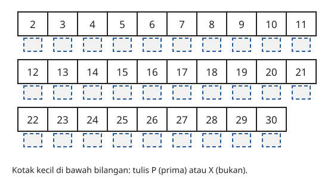

**Ingat dulu:** Tanpa melihat catatan, jawab. (1) Sebutkan dua cara menemukan galat dengan mencetak nilai dan uji kecil. ______ (2) Bagaimana mengubah karakter digit `'7'` menjadi bilangan 7? ______ (3) Mengapa uji prima cukup memeriksa pembagi sampai `i * i <= n`? ______



`[Gambar: tiga baris kotak berisi bilangan 2 sampai 30. Di bawah tiap bilangan ada kotak kecil kosong untuk menulis P (prima) atau X (bukan prima) mengikuti saringan.]`

**Prediksi:** Tebak dulu, tulis jawabanmu, baru jalankan (`AI: tanpa AI`).

```cpp
#include <iostream>
using namespace std;

int fpb(int a, int b) {
  while (b != 0) {
    int sisa = a % b;
    a = b;
    b = sisa;
  }
  return a;
}

int main() {
  cout << fpb(48, 18) << "\n";
  cout << fpb(17, 5) << "\n";
  cout << 48 / fpb(48, 18) * 18 << "\n";
}
```

Apa yang tercetak pada tiap baris? ______ Baris ketiga menghitung apa, dan mengapa dibagi dulu sebelum dikali? ______

**Lengkapi:** Saringan yang menghitung banyak bilangan prima sampai 30. Kerjakan saringan itu di kertas pada gambar, lalu isi bagian `____`.

```cpp setengah-jadi
#include <iostream>
using namespace std;

int main() {
  bool prima[31];
  for (int i = 2; i <= 30; i++) {
    prima[i] = ____;
  }
  for (int i = 2; i * i <= ____; i++) {
    if (prima[i]) {
      for (int j = ____; j <= 30; j += ____) {
        prima[j] = false;
      }
    }
  }
  int banyak = 0;
  for (int i = 2; i <= 30; i++) {
    if (prima[i]) {
      banyak++;
    }
  }
  cout << banyak << "\n";
}
```

**Susun:** Urutkan baris A sampai J (indentasi ikut barisnya) menjadi badan `main` yang mencetak faktor prima 12, satu per baris. `AI: tanpa AI`.

```text
(A)       n = n / i;
(B)   while (n > 1) {
(C)     }
(D)   int n = 12;
(E)       i++;
(F)       cout << i << "\n";
(G)   }
(H)   int i = 2;
(I)     } else {
(J)     if (n % i == 0) {
```

Urutan: ______ ______ ______ ______ ______ ______ ______ ______ ______ ______

**Latihan:**

1. `AI: tanpa AI` Buat tabel penelusuran program Parsons untuk `n = 252` (kolom `n`, `i`, dan faktor yang tercetak). Faktor apa saja yang tercetak, dan berapa kali `i` bertambah?

   | `n` | `i` | tercetak |
   | --- | --- | --- |
   | 252 | 2 | |
   | | | |
   | | | |

2. `AI: boleh` Tulis pseudocode yang membaca `n` dan mencetak banyak pembagi positifnya. Uji dengan 36. ______
3. `AI: boleh` Baca tiga bilangan dan cetak KPK-nya dengan `kpk(kpk(a, b), c)`. Uji dengan 4, 6, dan 10. ______

**Cek diri:**

- [ ] Saya dapat menghitung FPB dengan algoritma Euclid dan KPK dari FPB.
- [ ] Saya dapat menjelaskan mengapa uji prima berhenti di `i * i <= n`.
- [ ] Saya dapat menulis saringan sederhana.

**Catatan cetak (untuk guru, tidak dicetak):** dua halaman A4. Kunci ada di modul `a-x2-m5`, bagian "Kunci dan petunjuk". Lembar tidak memuat kolom identitas.
