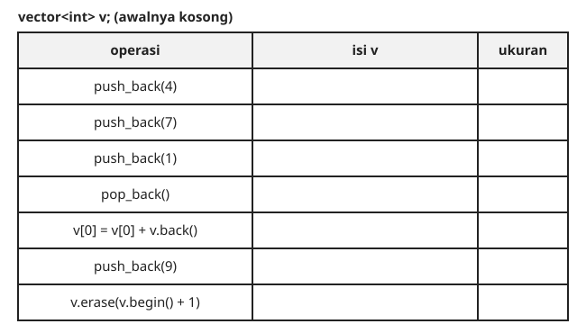

**Ingat dulu:** Tanpa melihat catatan, jawab. (1) Berapa FPB(48, 18), dan bagaimana KPK dihitung dari FPB? ______ (2) Sebutkan dua keuntungan memecah program menjadi fungsi. ______



`[Gambar: tabel dengan kolom operasi, isi v, dan ukuran. Tujuh baris operasi berurutan: push_back(4), push_back(7), push_back(1), pop_back(), v[0] = v[0] + v.back(), push_back(9), v.erase(v.begin() + 1). Vector v awalnya kosong. Kolom isi v dan ukuran kosong untuk kamu isi.]`

**Prediksi:** Tebak dulu, tulis jawabanmu, baru jalankan (`AI: tanpa AI`).

```cpp
#include <iostream>
#include <vector>
using namespace std;

int main() {
  vector<int> v;
  v.push_back(5);
  v.push_back(8);
  v.push_back(2);
  cout << v.size() << " " << v[1] << " " << v.back() << "\n";
  v.pop_back();
  v[0] = v[0] + 1;
  int n = v.size();
  for (int i = 0; i < n; i++) {
    if (i > 0) {
      cout << " ";
    }
    cout << v[i];
  }
  cout << "\n";
}
```

Apa yang tercetak pada tiap baris? ______ Berapa ukuran `v` pada akhir program? ______

**Lengkapi:** Program membaca bilangan sampai habis dan mencetak banyak dan jumlahnya. Isi bagian `____`.

```cpp setengah-jadi
#include <iostream>
#include <vector>
using namespace std;

int main() {
  vector<int> v;
  int x;
  while (cin >> ____) {
    v.____(x);
  }
  int n = v.____();
  long long jumlah = 0;
  for (int y : v) {
    jumlah += ____;
  }
  cout << "banyak = " << n << ", jumlah = " << jumlah << "\n";
}
```

**Susun:** Urutkan baris A sampai E (indentasi ikut barisnya) menjadi badan `main` yang mencetak isi `v` dari belakang ke depan dengan membuang elemen ujungnya satu per satu. `AI: tanpa AI`.

```text
(A)     v.pop_back();
(B)   vector<int> v = {3, 1, 4};
(C)   }
(D)   while (!v.empty()) {
(E)     cout << v.back() << "\n";
```

Urutan: ______ ______ ______ ______ ______

**Latihan:**

1. `AI: tanpa AI` Isi tabel pada gambar: tulis isi `v` dan ukurannya setelah tiap operasi. Berapa ukuran akhirnya? ______
2. `AI: boleh` Tulis pseudocode yang membaca bilangan sampai habis ke `vector`, lalu mencetak isi vector baru yang hanya memuat bilangan positif, dipisah spasi. Uji dengan 3 -1 4 0 -5 9. ______
3. `AI: boleh` Baca satu kata huruf kecil dan cetak tiap huruf yang muncul beserta banyaknya, berurutan menurut abjad, misalnya `a 2`. Pakai `vector<int> frek(26, 0)` dan `c - 'a'`. Uji dengan `algoritma`. ______

**Cek diri:**

- [ ] Saya dapat menambah dan menghapus elemen `vector`.
- [ ] Saya dapat membaca data sampai habis ke `vector`.
- [ ] Saya dapat menghitung frekuensi dengan `vector` penghitung.

**Catatan cetak (untuk guru, tidak dicetak):** satu sampai dua halaman A4. Kunci ada di modul `a-x2-m6`, bagian "Kunci dan petunjuk". Lembar tidak memuat kolom identitas.
