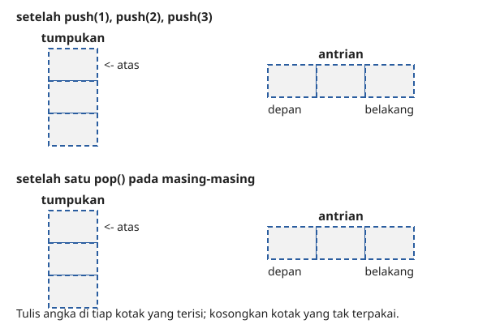

**Ingat dulu:** Tanpa melihat catatan, jawab. (1) Apa yang dilakukan `push_back` dan `pop_back`? ______ (2) Bagaimana mengambil digit terakhir bilangan bulat positif dan membuang digit itu? ______



`[Gambar: dua baris gambar. Baris atas berjudul "setelah push(1), push(2), push(3)": sebuah tumpukan vertikal tiga kotak kosong dengan penanda "atas", dan sebuah antrian horizontal tiga kotak kosong dengan penanda "depan" dan "belakang". Baris bawah berjudul "setelah satu pop() pada masing-masing": pasangan yang sama, juga kosong. Kamu mengisinya dengan angka.]`

**Prediksi:** Tebak dulu, tulis jawabanmu, baru jalankan (`AI: tanpa AI`). Isi kotak pada gambar.

```cpp
#include <iostream>
#include <queue>
#include <stack>
using namespace std;

int main() {
  stack<int> s;
  queue<int> q;
  for (int i = 1; i <= 3; i++) {
    s.push(i);
    q.push(i);
  }
  cout << s.top() << " " << q.front() << "\n";
  s.pop();
  q.pop();
  cout << s.top() << " " << q.front() << " " << s.size() << "\n";
}
```

Apa yang tercetak pada tiap baris? ______ Keduanya diisi 1, 2, 3 dalam urutan yang sama. Mengapa elemen yang terlihat berbeda? ______

**Lengkapi:** Membalik sebuah kata dengan tumpukan: huruf dimasukkan satu per satu, lalu diambil kembali dari atas. Isi bagian `____`.

```cpp setengah-jadi
#include <iostream>
#include <stack>
#include <string>
using namespace std;

int main() {
  stack<char> s;
  string t;
  cin >> t;
  for (char c : t) {
    s.____(c);
  }
  while (!s.____()) {
    cout << s.____();
    s.____();
  }
  cout << "\n";
}
```

**Susun:** Urutkan baris A sampai F menjadi badan `main` yang mencetak 5, lalu 8, dari sebuah antrian. Baris (C) dan (F) sama persis, jadi boleh bertukar tempat. `AI: tanpa AI`.

```text
(A)   q.pop();
(B)   queue<int> q;
(C)   cout << q.front() << "\n";
(D)   q.push(8);
(E)   q.push(5);
(F)   cout << q.front() << "\n";
```

Urutan: ______ ______ ______ ______ ______ ______

**Latihan:**

1. `AI: boleh` Tulis pseudocode yang menguji palindrom dengan satu tumpukan dan satu antrian: masukkan tiap huruf ke keduanya, lalu bandingkan huruf yang keluar dari tumpukan dengan huruf yang keluar dari antrian. Uji dengan `katak` dan `kayu`. ______
2. `AI: boleh` Baca satu kata berisi angka satu digit dan huruf `C`. Angka dimasukkan ke tumpukan; `C` mencetak angka teratas lalu membuangnya, atau mencetak `kosong` bila tumpukan kosong. Tulis pseudocodenya dan uji dengan `58C3CCC`. ______
3. `AI: tanpa AI` Sebut kapan pemeriksa kurung seimbang menjawab "tidak seimbang". ______

**Cek diri:**

- [ ] Saya dapat menjelaskan LIFO dan FIFO dengan contoh.
- [ ] Saya dapat memakai `push`, `top` atau `front`, `pop`, dan `empty`.
- [ ] Saya dapat memeriksa kurung seimbang dengan tumpukan.

**Catatan cetak (untuk guru, tidak dicetak):** dua halaman A4. Kunci ada di modul `a-x2-m7`, bagian "Kunci dan petunjuk". Lembar tidak memuat kolom identitas.
