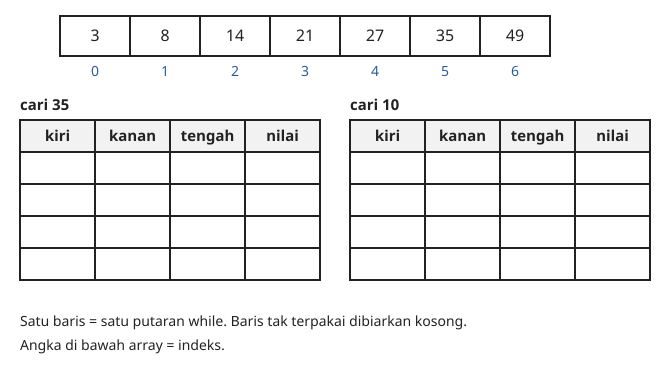

**Ingat dulu:** Tanpa melihat catatan, jawab. (1) Apa beda LIFO dan FIFO? Beri satu contoh sehari-hari untuk tiap-tiapnya. ______ (2) Tulis perulangan yang menjumlahkan semua elemen array `a` berukuran `n`. ______



`[Gambar: array terurut 3, 8, 14, 21, 27, 35, 49 dengan indeks 0 sampai 6. Di bawahnya dua tabel kosong berkolom kiri, kanan, tengah, dan nilai: yang kiri untuk mencari 35, yang kanan untuk mencari 10. Satu baris tabel untuk satu putaran while.]`

**Prediksi:** Tebak dulu, tulis jawabanmu, baru jalankan (`AI: tanpa AI`).

```cpp
#include <iostream>
#include <vector>
using namespace std;

int cariIndeks(vector<int>& v, int x, int& banding) {
  banding = 0;
  int n = v.size();
  for (int i = 0; i < n; i++) {
    banding++;
    if (v[i] == x) {
      return i;
    }
  }
  return -1;
}

int main() {
  vector<int> v = {4, 9, 7, 1, 7};
  int banding;
  cout << cariIndeks(v, 7, banding) << " " << banding << "\n";
  cout << cariIndeks(v, 5, banding) << " " << banding << "\n";
}
```

Apa yang tercetak pada tiap baris? ______ Angka 7 muncul dua kali. Mengapa fungsi hanya melaporkan satu indeks? ______

**Lengkapi:** Pencarian biner. Isi bagian `____`.

```cpp setengah-jadi
int cariBiner(vector<int>& v, int x) {
  int kiri = 0;
  int n = v.size();
  int kanan = n - 1;
  while (kiri ____ kanan) {
    int tengah = kiri + (kanan - kiri) / ____;
    if (v[tengah] == x) {
      return ____;
    } else if (v[tengah] < x) {
      kiri = ____;
    } else {
      kanan = ____;
    }
  }
  return -1;
}
```

**Susun:** Urutkan baris A sampai H (indentasi ikut barisnya) menjadi badan satu putaran `while` pencarian biner. `AI: tanpa AI`.

```text
(A)       kiri = tengah + 1;
(B)     int tengah = kiri + (kanan - kiri) / 2;
(C)       return tengah;
(D)     } else {
(E)       kanan = tengah - 1;
(F)     } else if (v[tengah] < x) {
(G)     if (v[tengah] == x) {
(H)     }
```

Urutan: ______ ______ ______ ______ ______ ______ ______ ______

**Latihan:**

1. `AI: tanpa AI` Isi kedua tabel pada gambar: telusuri pencarian biner pada data itu untuk `35`, lalu untuk `10`. Apa hasil tiap pencarian? ______
2. `AI: boleh` Rahasianya bilangan 1 sampai 100 yang dibaca dari masukan. Tulis pseudocode program yang menebak dengan membagi dua daerah tebakan dan mencetak tiap tebakan beserta penilaiannya (`terlalu kecil`, `terlalu besar`, atau `tepat`). Uji dengan rahasia 73. ______
3. `AI: boleh` Baca `n` bilangan, lalu `q` pertanyaan; untuk tiap pertanyaan cetak indeks pertama kemunculannya atau -1 dengan pencarian sekuensial. Uji dengan data `4 9 7 1 7` dan pertanyaan `7 5 4`. ______

**Cek diri:**

- [ ] Saya dapat menyebut syarat pencarian biner dan alasannya.
- [ ] Saya dapat menelusuri pencarian biner dengan tabel `kiri`, `kanan`, `tengah`.
- [ ] Saya dapat menjelaskan mengapa langkah biner naik pelan saat data membesar.

**Catatan cetak (untuk guru, tidak dicetak):** dua halaman A4. Kunci ada di modul `a-x2-m8`, bagian "Kunci dan petunjuk". Lembar tidak memuat kolom identitas.
