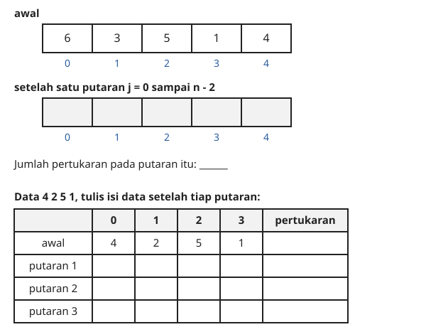

**Ingat dulu:** Tanpa melihat catatan, jawab. (1) Apa syarat data agar pencarian biner boleh dipakai, dan mengapa syarat itu perlu? ______ (2) Bagaimana menukar isi `a[i]` dan `a[j]`? ______



`[Gambar: bagian atas, array 6, 3, 5, 1, 4 berindeks 0 sampai 4 dan satu baris lima kotak kosong untuk isi array setelah satu putaran; di bawahnya garis isian jumlah pertukaran. Bagian bawah, tabel berkolom indeks 0 sampai 3 dan pertukaran, dengan baris awal 4 2 5 1 dan tiga baris putaran yang kosong.]`

**Prediksi:** Tebak dulu, tulis jawabanmu di gambar, baru jalankan (`AI: tanpa AI`).

```cpp
#include <iostream>
#include <vector>
using namespace std;

int main() {
  vector<int> v = {6, 3, 5, 1, 4};
  int n = v.size();
  int tukar = 0;
  for (int j = 0; j < n - 1; j++) {
    if (v[j] > v[j + 1]) {
      int t = v[j];
      v[j] = v[j + 1];
      v[j + 1] = t;
      tukar++;
    }
  }
  for (int i = 0; i < n; i++) {
    if (i > 0) {
      cout << " ";
    }
    cout << v[i];
  }
  cout << "\n" << "pertukaran: " << tukar << "\n";
}
```

Elemen mana yang sekarang pasti berada di tempat akhirnya? ______

**Lengkapi:** Bubble sort tanpa penghenti dini. Isi bagian `____`.

```cpp setengah-jadi
int n = v.size();
for (int putaran = 1; putaran < n; putaran++) {
  for (int j = 0; j < n - ____; j++) {
    if (v[j] ____ v[j + 1]) {
      int t = v[j];
      v[j] = ____;
      v[j + 1] = ____;
    }
  }
}
```

**Susun:** Urutkan baris A sampai G (indentasi ikut barisnya) menjadi satu putaran bubble sort yang menukar pasangan bertetangga bila terbalik. `AI: tanpa AI`.

```text
(A)     int t = v[j];
(B)     v[j] = v[j + 1];
(C)   for (int j = 0; j < n - 1; j++) {
(D)     v[j + 1] = t;
(E)   }
(F)   if (v[j] > v[j + 1]) {
(G)   }
```

Urutan: ______ ______ ______ ______ ______ ______ ______

**Latihan:**

1. `AI: tanpa AI` Untuk data `4 2 5 1`, isi tabel pada gambar: tulis isi data setelah tiap putaran dan jumlah pertukaran seluruhnya. ______
2. `AI: boleh` Tulis pseudocode yang membaca `n` bilangan, mengurutkannya **menurun** dengan bubble sort, lalu mencetak hasilnya dan banyak pertukaran. Uji dengan `5` dan `2 7 4 9 1`. ______
3. `AI: boleh` Baca `n` kata, urutkan menurut abjad dengan bubble sort (bandingkan `string` dengan `>`). Tulis pseudocodenya dan uji dengan `4` dan `kuda apel zebra bunga`. ______

**Cek diri:**

- [ ] Saya dapat menelusuri bubble sort putaran demi putaran.
- [ ] Saya dapat menghitung banyak perbandingan dan pertukaran.
- [ ] Saya dapat menjelaskan mengapa langkahnya naik secara kuadrat.

**Catatan cetak (untuk guru, tidak dicetak):** dua halaman A4. Kunci ada di modul `a-x2-m9`, bagian "Kunci dan petunjuk". Lembar tidak memuat kolom identitas.
