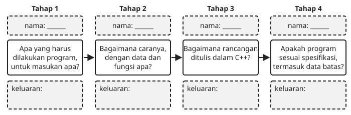

**Ingat dulu:** Tanpa melihat catatan, jawab dua soal ini.

1. Mengapa kedua kolom sebuah tabel harus dipindahkan bersama saat diurutkan? ______
2. Mengapa pemeriksaan kurung seimbang cocok memakai tumpukan? ______



`[Gambar: empat kotak berurutan dari kiri ke kanan dihubungkan panah. Tiap kotak memuat satu pertanyaan utama: apa yang harus dilakukan program untuk masukan apa; bagaimana caranya dengan data dan fungsi apa; bagaimana rancangan ditulis dalam C++; apakah program sesuai spesifikasi termasuk data batas. Nama tahap dan keluaran tiap tahap berupa kotak kosong yang kamu isi.]`

Isi nama tahap dan satu keluaran tiap tahap pada gambar.

**Prediksi:** Spesifikasi karangan: "cetak rata-rata skor dengan dua angka di belakang koma". Tulis tebakanmu sebelum menjalankan.

```cpp
#include <iomanip>
#include <iostream>
using namespace std;

int rataRata(int jumlah, int n) {
  return jumlah / n;
}

int main() {
  cout << rataRata(23, 3) << " " << rataRata(24, 3) << "\n";
  cout << fixed << setprecision(2) << 23 / 3.0 << "\n";
}
```

Baris pertama tercetak: ______. Baris kedua tercetak: ______.

Apakah baris pertama memenuhi spesifikasi? ______ Di tahap mana cacatnya paling tepat diperbaiki? ______

**Lengkapi:** Fungsi yang menghitung banyak skor di antara dua batas, inklusif (`dari <= skor <= sampai`).

```cpp setengah-jadi
int banyakDi(const vector<int>& skor, int dari, int sampai) {
  int banyak = 0;
  for (int i = 0; i < (int)skor.size(); i++) {
    if (skor[i] >= ____ && skor[i] ____ sampai) {
      banyak++;
    }
  }
  return ____;
}
```

**Susun:** Susun baris berikut menjadi fungsi `tertinggi`. `AI: tanpa AI`.

```text
(a)     if (skor[i] > hasil) {
(b)   int hasil = skor[0];
(c) int tertinggi(const vector<int>& skor) {
(d)   return hasil;
(e)       hasil = skor[i];
(f)     }
(g)   for (int i = 1; i < (int)skor.size(); i++) {
(h)   }
(i) }
```

Urutan: ______

**Latihan:**

1. `AI: tanpa AI` Nyatakan tahap tempat cacat sebaiknya diperbaiki: (a) program mencetak 7 padahal yang diminta 7,67 ______; (b) spesifikasi tidak menyebut apa yang terjadi bila `n = 0` ______; (c) program mencatat `skor[i] > 60` padahal aturannya "paling sedikit 60" ______; (d) tidak ada kasus uji dengan `n = 1` ______.
2. `AI: tanpa AI` Untuk program rekap skor, tulis tiga kasus uji batas beserta keluaran harapan yang kamu hitung dengan tangan: skor semua sama; skor 59 dan 60; `n = 2` dengan skor 0 dan 100.

   ______

3. `AI: boleh` Rancang dulu: rekap pemakaian lab komputer, `n` sesi, tiap sesi berisi lama pakai dalam menit. Tulis lima bagian dokumen satu halaman: masukan, keluaran, batasan, aturan, contoh.

   ______

**Cek diri:**

- [ ] Saya dapat menyebut empat tahap proses rekayasa program dan keluaran tiap tahap.
- [ ] Saya dapat menulis spesifikasi dengan masukan, keluaran, batasan, aturan, dan contoh.
- [ ] Saya menghitung keluaran harapan dengan tangan sebelum menjalankan program.

**Catatan cetak (untuk guru, tidak dicetak):** dua halaman A4. Kunci ada di modul `a-xi1-m1`, bagian "Kunci dan petunjuk". Lembar tidak memuat kolom identitas.
