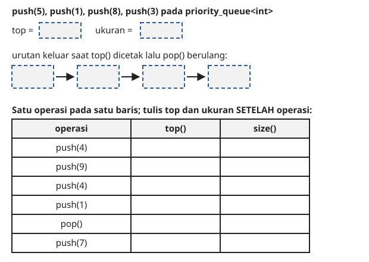

**Ingat dulu:** Tanpa melihat catatan, jawab. (1) Apa yang terjadi bila `m["x"]` dibaca padahal kunci `"x"` belum ada di `map`? ______ (2) Mengapa fungsi kecil dengan satu tugas lebih mudah diuji daripada satu fungsi panjang? ______



`[Gambar: bagian atas berjudul "push(5), push(1), push(8), push(3) pada priority_queue<int>": dua kotak isian "top" dan "ukuran", lalu empat kotak kosong berpanah untuk urutan keluar saat top() dicetak dan pop() dipanggil berulang. Bagian bawah: tabel enam operasi (push(4), push(9), push(4), push(1), pop(), push(7)) dengan kolom top() dan size() kosong.]`

**Prediksi:** Tebak dulu, tulis jawabanmu di bagian atas gambar, baru jalankan (`AI: tanpa AI`).

```cpp
#include <iostream>
#include <queue>
using namespace std;

int main() {
  priority_queue<int> pq;
  pq.push(5);
  pq.push(1);
  pq.push(8);
  pq.push(3);
  cout << "top: " << pq.top() << ", ukuran: " << pq.size() << "\n";
  while (!pq.empty()) {
    cout << pq.top() << " ";
    pq.pop();
  }
  cout << "\n";
}
```

Apakah urutan keluarnya sama dengan `queue` biasa? ______

**Lengkapi:** Mencetak `k` bilangan **terkecil** dengan heap terbesar (`priority_queue` bawaan) berukuran paling banyak `k`. Isi bagian `____`.

```cpp setengah-jadi
priority_queue<int> pq;
for (int i = 0; i < n; i++) {
  int x;
  cin >> x;
  pq.push(x);
  if ((int)pq.size() > ____) {
    pq.____();
  }
}
```

**Susun:** Urutkan baris A sampai H menjadi program yang mencetak bilangan terbesar ke-`k`. `AI: tanpa AI`.

```text
(A)   priority_queue<int, vector<int>, greater<int>> pq;
(B)   for (int i = 0; i < n; i++) {
(C)     cin >> x;
(D)     pq.push(x);
(E)     if ((int)pq.size() > k) pq.pop();
(F)   }
(G)   int x;
(H)   cout << pq.top() << "\n";
```

Urutan: ______ ______ ______ ______ ______ ______ ______ ______

**Latihan:**

1. `AI: tanpa AI` Isi tabel pada gambar untuk `priority_queue<int>` kosong: tulis `top()` dan `size()` setelah tiap operasi. ______
2. `AI: boleh` Baca `n` dan `k`, lalu `n` bilangan. Tulis pseudocode untuk mencetak `k` bilangan terbesar dari yang terbesar. ______
3. `AI: boleh` Baca `n`, lalu `n` pasang `prioritas nama` (angka kecil didahulukan). Tulis cara mencetak urutan penanganan dengan `priority_queue` dan `greater`. ______
4. `AI: boleh` Untuk `n = 1000000` dan `k = 10`, bandingkan perkiraan langkah cara heap dan cara urut penuh. Mengapa memori cara heap lebih kecil? ______

**Cek diri:**

- [ ] Saya dapat memakai `push`, `top`, `pop`, `size`, dan `empty`.
- [ ] Saya dapat menyelesaikan k nilai terbesar dengan heap berukuran k.
- [ ] Saya dapat menyebut `O(log n)` untuk `push` dan `pop`.

**Catatan cetak (untuk guru, tidak dicetak):** dua halaman A4. Kunci ada di modul `a-xi1-m10`, bagian "Kunci dan petunjuk". Lembar tidak memuat kolom identitas.
