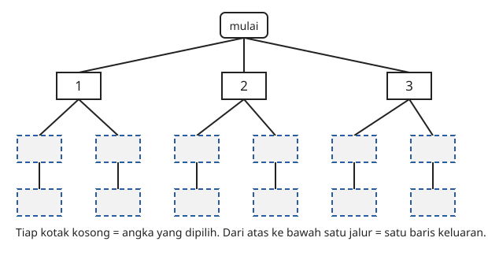

**Ingat dulu:** Tanpa melihat catatan, jawab. (1) Elemen mana yang dikeluarkan `top()` pada `priority_queue<int>` bawaan, dan bagaimana membuatnya mengeluarkan yang terkecil? ______ (2) Pada rekursi subhimpunan, apa dua pilihan di tiap elemen dan kapan rekursi berhenti? ______



`[Gambar: pohon dengan akar "mulai", tiga cabang berisi 1, 2, dan 3. Di bawah tiap cabang ada dua kotak kosong untuk pilihan kedua, dan di bawah tiap kotak itu satu kotak kosong untuk pilihan ketiga. Satu jalur dari atas ke bawah sama dengan satu baris keluaran.]`

**Prediksi:** Tebak dulu, isi kotak pada pohon, baru jalankan (`AI: tanpa AI`).

```cpp
#include <iostream>
#include <vector>
using namespace std;

void susun(int pos, int n, vector<int>& cur, vector<bool>& dipakai) {
  if (pos == n) {
    for (int x : cur) {
      cout << x << " ";
    }
    cout << "\n";
    return;
  }
  for (int x = 1; x <= n; x++) {
    if (dipakai[x]) {
      continue;
    }
    dipakai[x] = true;
    cur.push_back(x);
    susun(pos + 1, n, cur, dipakai);
    cur.pop_back();
    dipakai[x] = false;
  }
}

int main() {
  int n = 3;
  vector<int> cur;
  vector<bool> dipakai(n + 1, false);
  susun(0, n, cur, dipakai);
}
```

Ada berapa baris, dan baris apa yang pertama dan terakhir? ______ Apa yang terjadi bila dua baris `cur.pop_back(); dipakai[x] = false;` dihapus? ______

**Lengkapi:** Menghitung banyak "kode bendera": string sepanjang `n` dari huruf `A`, `B`, `C` tanpa dua huruf yang sama berdampingan. Isi bagian `____`.

```cpp setengah-jadi
void bangun(string& s, int n, int& jumlah) {
  if ((int)s.size() == n) {
    jumlah++;
    return;
  }
  for (char c = 'A'; c <= 'C'; c++) {
    if (!s.empty() && s.back() ____ c) {
      continue;
    }
    s.push_back(c);
    bangun(s, n, jumlah);
    s.____();
  }
}
```

**Susun:** Urutkan baris A sampai I menjadi fungsi `susun` untuk permutasi. Dua baris `}` identik; yang pertama menutup `for`. `AI: tanpa AI`.

```text
(A)   cur.pop_back(); dipakai[x] = false;
(B)   if (pos == n) { cetak(); return; }
(C)   }
(D) void susun(int pos) {
(E)     susun(pos + 1);
(F)   for (int x = 1; x <= n; x++) {
(G)     dipakai[x] = true; cur.push_back(x);
(H)     if (dipakai[x]) continue;
(I) }
```

Urutan: ______ ______ ______ ______ ______ ______ ______ ______ ______

**Latihan:**

1. `AI: tanpa AI` Berapa kali `susun` dipanggil untuk `n = 4`, termasuk pemanggilan pada daun? Hitung tingkat demi tingkat. ______
2. `AI: boleh` Baca `n`. Tulis pseudocode untuk menghitung berapa permutasi dari `1..n` yang tidak menaruh angka `i` di posisi ke-`i`. ______
3. `AI: boleh` Baca `n` dan `k`. Tulis pseudocode untuk mencetak semua pilihan `k` angka berbeda dari `1..n` dalam urutan menaik, satu pilihan per baris. ______

**Cek diri:**

- [ ] Saya dapat menelusuri pilih, jelajahi, dan batalkan.
- [ ] Saya dapat menghitung banyak pemanggilan untuk ukuran kecil.
- [ ] Saya dapat menjelaskan fungsi pemangkasan dan syarat amannya.

**Catatan cetak (untuk guru, tidak dicetak):** dua halaman A4. Kunci ada di modul `a-xi1-m11`, bagian "Kunci dan petunjuk". Lembar tidak memuat kolom identitas.
