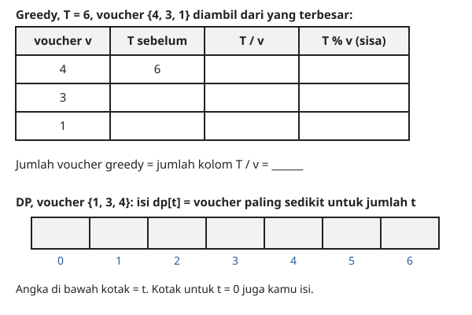

**Ingat dulu:** Tanpa melihat catatan, jawab. (1) Sebutkan tiga bagian tiap langkah backtracking. ______ (2) Apa beda `set` dan `map`, dan kapan memilih masing-masing? ______



`[Gambar: bagian atas, tabel greedy dengan voucher 4, 3, 1 dan kolom "T sebelum" (baris pertama 6), "T / v", dan "T % v (sisa)" yang kosong. Bagian bawah, larik dp dengan tujuh kotak kosong berindeks 0 sampai 6 untuk voucher paling sedikit pada tiap jumlah t, dengan voucher {1, 3, 4}.]`

**Prediksi:** Tebak dulu, tulis jawabanmu di tabel greedy pada gambar, baru jalankan (`AI: tanpa AI`).

```cpp
#include <iostream>
#include <vector>
using namespace std;

int serakah(const vector<int>& voucher, int T) {
  int jumlah = 0;
  for (int v : voucher) {
    jumlah += T / v;
    T = T % v;
  }
  return jumlah;
}

int main() {
  vector<int> voucher = {4, 3, 1};
  cout << "T = 6: " << serakah(voucher, 6) << " voucher\n";
  cout << "T = 7: " << serakah(voucher, 7) << " voucher\n";
}
```

Adakah cara memakai lebih sedikit voucher untuk `T = 6`? Tulis caranya. ______

**Lengkapi:** Pengisian tabel DP untuk voucher `{1, 3, 4}`. Isi bagian `____`, lalu isi larik dp pada gambar.

```cpp setengah-jadi
vector<int> dp(T + 1, 1000000);
dp[0] = ____;
for (int t = 1; t <= T; t++) {
  for (int v : voucher) {
    if (v <= t && dp[t - v] + 1 < dp[t]) {
      dp[t] = dp[t - v] + ____;
    }
  }
}
```

**Susun:** Urutkan baris A sampai H menjadi fungsi yang mengembalikan voucher paling sedikit untuk `T`. `AI: tanpa AI`.

```text
(A)   dp[0] = 0;
(B)   for (int t = 1; t <= T; t++) {
(C)   vector<int> dp(T + 1, TAK_HINGGA);
(D)     for (int v : voucher) {
(E)       if (v <= t) dp[t] = min(dp[t], dp[t - v] + 1);
(F)     }
(G)   }
(H)   return dp[T];
```

Urutan: ______ ______ ______ ______ ______ ______ ______ ______

**Latihan:**

1. `AI: boleh` Untuk voucher `{6, 5, 1}`, tulis pseudocode program yang mencari `T` terkecil sampai 30 tempat greedy dan DP berbeda. ______
2. `AI: tanpa AI` Pilih satu strategi (greedy, pencarian lengkap, atau DP) dan beri alasan untuk tiap keadaan: (a) voucher `{1, 5, 10, 25}` dan banyak pertanyaan; (b) 20 bilangan dan dicari himpunan bagian yang jumlahnya tepat `T`; (c) voucher `{1, 3, 4}` dan `T = 100000`. ______
3. `AI: boleh` Tambahkan ke solusi DP pencatatan voucher yang dipakai. Tulis cara kerjanya untuk `T = 10`. ______

**Cek diri:**

- [ ] Saya dapat mencari data yang membuat greedy salah.
- [ ] Saya dapat menghitung banyak langkah tiap strategi.
- [ ] Saya dapat memilih strategi dan menjelaskan alasannya.

**Catatan cetak (untuk guru, tidak dicetak):** dua halaman A4. Kunci ada di modul `a-xi1-m12`, bagian "Kunci dan petunjuk". Lembar tidak memuat kolom identitas.
