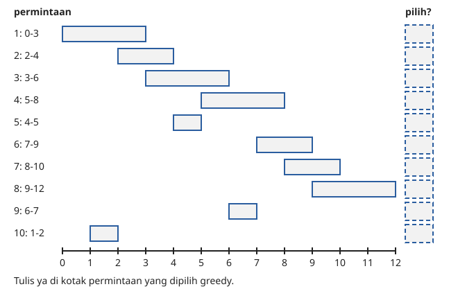

**Ingat dulu:** Tanpa melihat catatan, jawab. (1) Mengapa greedy bisa gagal, dan beri satu contoh voucher yang menunjukkannya? ______ (2) Bagaimana pencarian lengkap pada data kecil dipakai untuk menguji sebuah greedy? ______



`[Gambar: garis waktu 0 sampai 12 dengan sepuluh batang untuk permintaan 1: 0-3, 2: 2-4, 3: 3-6, 4: 5-8, 5: 4-5, 6: 7-9, 7: 8-10, 8: 9-12, 9: 6-7, dan 10: 1-2. Di kanan tiap batang ada kotak "pilih?" yang kosong. Satu ruang latihan; dua permintaan boleh berurutan bila yang kedua mulai tepat saat yang pertama selesai.]`

**Prediksi:** Klub karangan punya satu ruang latihan dan memilih permintaan sebanyak mungkin yang tidak bertumpuk. Aturan greedy: urutkan menurut jam selesai, pilih permintaan yang mulainya tidak lebih awal daripada selesai pilihan terakhir. Tebak dulu berapa permintaan yang terpilih dari sepuluh pada gambar, lalu tulis ya di kotak permintaan yang dipilih. ______

**Lengkapi:** Pembanding untuk pengurutan menurut jam selesai, lalu satu putaran greedy. Isi bagian `____`.

```cpp setengah-jadi
bool lebihDulu(const Minta& a, const Minta& b) {
  if (a.selesai != b.selesai) {
    return a.selesai ____ b.selesai;
  }
  return a.mulai < b.mulai;
}

// greedy, setelah diurutkan:
int akhir = -1000000;
int terpilih = 0;
for (const Minta& x : m) {
  if (x.mulai ____ akhir) {
    terpilih++;
    akhir = x.____;
  }
}
```

**Latihan:**

1. `AI: boleh` Ubah syarat `m[i].mulai >= akhir` menjadi `m[i].mulai > akhir`. Apa artinya bagi permintaan yang berurutan, dan data mana pada gambar yang berubah jawabannya? ______
2. `AI: tanpa AI` Mengapa pengurutan menurut jam selesai, bukan menurut jam mulai, yang dipakai greedy ini? Beri satu contoh kecil yang menunjukkan urutan menurut mulai bisa salah. ______
3. `AI: boleh` Tulis pembanding lain yang mengurutkan menurut lama kegiatan (`selesai - mulai`) menaik. Apakah greedy dengan urutan itu selalu benar? Bagaimana mengujinya dengan cara periksa? ______

**Cek diri:**

- [ ] Saya dapat menyebut aturan, keluaran, dan kriteria selesai proyek saya.
- [ ] Saya memeriksa cara cepat dengan cara lengkap pada data kecil.
- [ ] Saya menguji nilai biasa, nilai batas, `n = 0`, dan `n = 1`.

**Catatan cetak (untuk guru, tidak dicetak):** dua halaman A4; proyek dinilai dengan rubrik dari guru. Kunci ada di modul `a-xi1-m13`, bagian "Kunci dan petunjuk". Lembar tidak memuat kolom identitas.
