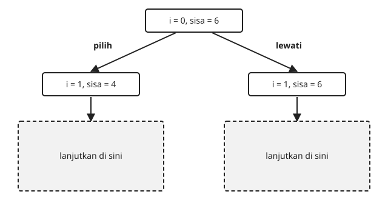

**Ingat dulu:** Tanpa melihat catatan, jawab tiga soal ini.

1. Mengapa pemangkasan menghemat langkah, dan syarat apa yang membuatnya aman? ______
2. Mengapa pembanding untuk `std::sort` memakai `<`, bukan `<=`? ______
3. Apa yang terjadi bila `m[k]` dibaca padahal kunci `k` belum ada di `map`? ______



`[Gambar: pohon pemanggilan hitung(0, 6) dengan pangkal i = 0, sisa = 6. Dua anak di tingkat pertama: cabang "pilih" ke i = 1, sisa = 4 dan cabang "lewati" ke i = 1, sisa = 6. Bagian di bawahnya area kosong bergaris putus-putus untuk kamu lanjutkan.]`

Pakai gambar untuk nomor 1 di bagian Latihan: lanjutkan pohonnya sampai kasus dasar.

**Latihan:** Kerjakan sendiri, `AI: tanpa AI`, dengan waktu yang ditetapkan gurumu.

1. Program berikut dijalankan. Apa yang tercetak, dan berapa kali `hitung` dipanggil untuk `hitung(0, 6)`? Gambar pohon pemanggilannya pada gambar.

   ```cpp
   #include <iostream>
   using namespace std;

   int a[3] = {2, 3, 4};

   int hitung(int i, int sisa) {
     if (sisa == 0) {
       return 1;
     }
     if (i == 3 || sisa < 0) {
       return 0;
     }
     return hitung(i + 1, sisa - a[i]) + hitung(i + 1, sisa);
   }

   int main() {
     cout << hitung(0, 6) << "\n";
   }
   ```

   Tercetak: ______ Banyak pemanggilan: ______

2. Tulis pseudocode lalu program: baca `n`, lalu `n` pasang `nama skor`. Cetak peringkat dengan skor menurun, dan nama menaik bila skor sama; lalu cetak banyak skor yang berbeda. Pakai `std::sort` dengan pembanding sendiri dan `set`.

   ______

3. Tiga potongan berikut sengaja salah. Untuk tiap potongan tulis galatnya, akibatnya, dan perbaikannya.

   ```text
   (a) bool lebihDulu(const Murid& a, const Murid& b) { return a.nilai >= b.nilai; }
   (b) cur.push_back(x);
       susun(pos + 1, n, cur, dipakai);
   (c) if (frek["pir"] > 0) { cout << "ada pir\n"; }
   ```

   (a) ______ (b) ______ (c) ______

4. Beri satu himpunan voucher dan satu `T` yang membuat greedy "terbesar dulu" gagal, lengkap dengan hitungannya. ______

**Cek diri:**

- [ ] Saya dapat menelusuri rekursi dan backtracking dan menghitung pemanggilannya.
- [ ] Saya dapat menemukan galat pembanding, lupa membatalkan pilihan, dan `m[k]` yang membuat entri.
- [ ] Saya dapat mengompilasi dan menguji programku dengan nilai batas.

**Catatan cetak (untuk guru, tidak dicetak):** dua halaman A4. Kunci ada di modul `a-xi1-m14`, bagian "Kunci dan petunjuk". Bagian Prediksi, Lengkapi, dan Susun dilewati karena modul asesmen ini tidak memuatnya. Lembar tidak memuat kolom identitas.
