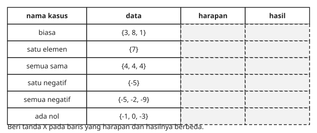

**Ingat dulu:** Tanpa melihat catatan, jawab dua soal ini.

1. Sebutkan tiga uji batas untuk program yang mengelola tabel data. ______
2. Kira-kira berapa langkah pencarian biner untuk 1000 data, dibanding pencarian sekuensial pada kasus terburuk? ______



`[Gambar: tabel enam baris kasus uji fungsi terbesar dengan kolom nama kasus, data, harapan, dan hasil fungsi dengan hasil awal 0. Nama kasus dan data terisi: biasa {3, 8, 1}; satu elemen {7}; semua sama {4, 4, 4}; satu negatif {-5}; semua negatif {-5, -2, -9}; ada nol {-1, 0, -3}. Kolom harapan dan hasil kosong untuk kamu isi.]`

Isi kolom harapan (hitung dengan tangan) dan kolom hasil (telusuri fungsi di bawah). Tandai baris yang berbeda.

**Prediksi:** Fungsi ini seharusnya mengembalikan nilai terbesar sebuah larik. Tulis tebakanmu sebelum menjalankan.

```cpp
#include <iostream>
#include <vector>
using namespace std;

int terbesar(const vector<int>& v) {
  int hasil = 0;
  for (int i = 0; i < (int)v.size(); i++) {
    if (v[i] > hasil) {
      hasil = v[i];
    }
  }
  return hasil;
}

int main() {
  vector<int> a = {3, 8, 1};
  vector<int> b = {-5, -2, -9};
  cout << terbesar(a) << " " << terbesar(b) << "\n";
}
```

Tercetak: ______. Bila fungsi diuji hanya dengan `a`, apakah cacatnya ketahuan? ______ Data macam apa yang memancingnya? ______

**Lengkapi:** Fungsi `terkecil` yang benar untuk data negatif.

```cpp setengah-jadi
int terkecil(const vector<int>& v) {
  int hasil = ____;
  for (int i = 1; i < (int)v.size(); i++) {
    if (v[i] ____ hasil) {
      hasil = v[i];
    }
  }
  return hasil;
}
```

**Susun:** Susun baris berikut menjadi fungsi `uji` yang mencetak `LULUS` atau `GAGAL`. `AI: tanpa AI`.

```text
(a)   if (hasil == harapan) {
(b)   int hasil = terbesar(data);
(c)     cout << "GAGAL\n";
(d) void uji(const vector<int>& data, int harapan) {
(e)   } else {
(f)     cout << "LULUS\n";
(g)   }
(h) }
```

Urutan: ______

**Latihan:**

1. `AI: tanpa AI` Berkas uji tepi untuk program rekap skor: tulis empat masukan yang menyentuh batas (`n = 1`, skor tepat 60, semua skor 0, semua skor 100) beserta keluaran harapan yang kamu hitung dengan tangan.

   ______

2. `AI: tanpa AI` Kamu tidak tahu jawaban benar sebuah fungsi `urutkan`. Sebutkan dua sifat hasilnya yang dapat kamu periksa tanpa menyelesaikan masalahnya sendiri. ______
3. `AI: tanpa AI` Cacat "program mencetak 7, padahal 7,67" ditemukan saat uji. Di tahap mana ia diperbaiki, dan kasus uji apa yang kamu tambahkan agar tidak muncul lagi? ______

**Cek diri:**

- [ ] Saya dapat menulis kasus uji biasa, batas, dan pemancing cacat.
- [ ] Saya menghitung keluaran harapan dengan tangan, bukan dari program.
- [ ] Saya mengompilasi dengan `-Wall -Wextra -Werror` dan memperbaiki setiap peringatan.

**Catatan cetak (untuk guru, tidak dicetak):** dua halaman A4. Kunci ada di modul `a-xi1-m2`, bagian "Kunci dan petunjuk". Lembar tidak memuat kolom identitas.
