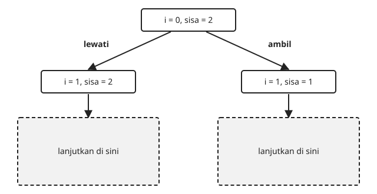

**Ingat dulu:** Tanpa melihat catatan, jawab dua soal ini.

1. Mengapa rekursi tanpa kasus dasar berbahaya, dan apa hubungannya dengan tumpukan pemanggilan? ______
2. Mengapa bubble sort boleh berhenti lebih awal bila satu putaran tidak menukar apa pun? ______



`[Gambar: pohon pemanggilan fungsi hitung untuk a = {1, 2} dan target 2. Pangkal berlabel i = 0, sisa = 2. Dua anak di tingkat pertama: cabang "lewati" ke i = 1, sisa = 2 dan cabang "ambil" ke i = 1, sisa = 1. Bagian di bawahnya berupa area kosong bergaris putus-putus untuk kamu lanjutkan.]`

Lanjutkan pohon pada area kosong sampai kasus dasar, lalu lingkari daun yang bernilai 1.

**Prediksi:** Fungsi menghitung banyak cara memilih elemen larik (boleh tidak satu pun) sehingga jumlahnya tepat `sisa`. Tulis tebakanmu sebelum menjalankan.

```cpp
#include <iostream>
#include <vector>
using namespace std;

int hitung(const vector<int>& a, int i, int sisa) {
  if (i == (int)a.size()) {
    return sisa == 0 ? 1 : 0;
  }
  return hitung(a, i + 1, sisa) + hitung(a, i + 1, sisa - a[i]);
}

int main() {
  vector<int> a = {2, 3, 5};
  cout << hitung(a, 0, 5) << " " << hitung(a, 0, 0) << "\n";
}
```

Tercetak: ______. Mengapa pemilihan "tidak satu pun elemen" ikut terhitung untuk sisa 0? ______

**Lengkapi:** Kasus dasar yang benar untuk larik kosong.

```cpp setengah-jadi
int hitung(const vector<int>& a, int i, int sisa) {
  if (i == ____) {
    return sisa == ____ ? 1 : 0;
  }
  return hitung(a, i + 1, sisa) + hitung(a, ____, sisa - a[i]);
}
```

**Susun:** Susun baris berikut menjadi fungsi tiga perulangan bersarang yang menghitung banyak tiga bilangan (indeks `i < j < k`) berjumlah `target`. `AI: tanpa AI`.

```text
(a)       for (int k = j + 1; k < n; k++) {
(b)   int banyak = 0;
(c)         if (a[i] + a[j] + a[k] == target) banyak++;
(d)     for (int j = i + 1; j < n; j++) {
(e)   for (int i = 0; i < n; i++) {
(f)       }
(g)     }
(h)   }
```

Urutan: ______

**Latihan:**

1. `AI: tanpa AI` Untuk `a = {1, 2}` dan target 2, gambar pohon pemanggilan `hitung` di gambar. Berapa pemanggilan? ______ Berapa subhimpunan yang cocok? ______
2. `AI: boleh` Tulis pseudocode lalu program yang membaca `n` (paling banyak 15), target, dan `n` bilangan positif, lalu mencetak banyak subhimpunan berjumlah target. Uji dengan tiga kasus, termasuk tanpa jawaban dan target 0.

   ______

3. `AI: boleh` Ubah rekursi nomor 2 supaya hanya menghitung subhimpunan berukuran tepat `k`. Parameter apa yang perlu ditambahkan? ______

**Cek diri:**

- [ ] Saya dapat menjelaskan pencarian lengkap dan mengapa ia selalu benar.
- [ ] Saya dapat menulis rekursi ambil-atau-lewati untuk subhimpunan.
- [ ] Saya dapat memperkirakan banyak langkah dan memilih batas `n`.

**Catatan cetak (untuk guru, tidak dicetak):** dua halaman A4. Kunci ada di modul `a-xi1-m3`, bagian "Kunci dan petunjuk". Lembar tidak memuat kolom identitas.
