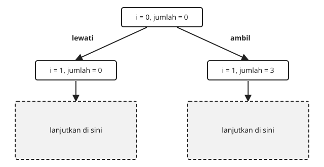

**Ingat dulu:** Tanpa melihat catatan, jawab dua soal ini.

1. Berapa banyak subhimpunan sebuah himpunan `n` elemen, dan mengapa? ______
2. Mengapa elemen yang akan disisipkan harus disimpan di variabel sebelum elemen lain digeser? ______



`[Gambar: pohon pemanggilan fungsi dengan pemangkasan untuk a = {3, 2, 1} dan batas = 4. Pangkal berlabel i = 0, jumlah = 0. Dua anak: cabang "lewati" ke i = 1, jumlah = 0 dan cabang "ambil" ke i = 1, jumlah = 3. Bagian di bawahnya berupa area kosong bergaris putus-putus untuk kamu lanjutkan.]`

Lanjutkan pohon pada area kosong. Beri tanda X pada cabang yang terpangkas.

**Prediksi:** Semua bilangan positif. `hitungA` memeriksa di ujung rekursi, `hitungB` langsung berhenti begitu jumlahnya melewati batas. Tulis tebakanmu sebelum menjalankan.

```cpp
#include <iostream>
#include <vector>
using namespace std;

int a[4] = {5, 4, 3, 2};
int batas = 6;
int panggilanA = 0;
int panggilanB = 0;

int hitungA(int i, int jumlah) {
  panggilanA++;
  if (i == 4) {
    return jumlah <= batas ? 1 : 0;
  }
  return hitungA(i + 1, jumlah) + hitungA(i + 1, jumlah + a[i]);
}

int hitungB(int i, int jumlah) {
  panggilanB++;
  if (jumlah > batas) {
    return 0;
  }
  if (i == 4) {
    return 1;
  }
  return hitungB(i + 1, jumlah) + hitungB(i + 1, jumlah + a[i]);
}

int main() {
  cout << hitungA(0, 0) << " " << panggilanA << "\n";
  cout << hitungB(0, 0) << " " << panggilanB << "\n";
}
```

Apakah kedua fungsi mencetak jawaban yang sama? ______ Berapa banyak subhimpunan? ______ Mana yang melakukan lebih sedikit pemanggilan? ______

**Lengkapi:** Pemangkasan untuk memilih tepat `k` elemen berjumlah paling banyak `batas`, bilangan positif.

```cpp setengah-jadi
long long hitung(const vector<int>& a, int i, int dipilih, int jumlah, int k, int batas) {
  if (jumlah ____ batas) return 0;
  if (dipilih == k) return 1;
  if (i == (int)a.size()) return 0;
  if (dipilih + ((int)a.size() - i) < ____) return 0;
  return hitung(a, i + 1, dipilih, jumlah, k, batas) + hitung(a, i + 1, ____, jumlah + a[i], k, batas);
}
```

**Susun:** Susun baris berikut menjadi fungsi pencarian dengan pemangkasan jumlah. `AI: tanpa AI`.

```text
(a)   if (jumlah > batas) return 0;
(b)   if (i == n) return 1;
(c) int cari(int i, int jumlah) {
(d)   return cari(i + 1, jumlah) + cari(i + 1, jumlah + a[i]);
(e) }
```

Urutan: ______

**Latihan:**

1. `AI: tanpa AI` Untuk `a = {3, 2, 1}` dan `batas = 4`, gambar pohon pemanggilan di gambar. Cabang mana yang terpangkas, dan berapa pemanggilannya? ______
2. `AI: boleh` Diberikan `n` bilangan positif terurut menaik dan `batas`, hitung banyak pasangan `i < j` dengan `a[i] + a[j] <= batas`. Pakai `break` pada perulangan dalam begitu jumlah melewati batas. Berapa langkah terburuknya? ______
3. `AI: tanpa AI` Beri contoh larik berisi bilangan negatif sehingga pemangkasan "jumlah melewati batas, maka berhenti" membuang jawaban yang benar. ______

**Cek diri:**

- [ ] Saya dapat menyebut syarat sahnya sebuah pemangkasan.
- [ ] Saya dapat menambahkan pemangkasan pada rekursi dan menghitung pemanggilannya.
- [ ] Saya membandingkan versi dengan dan tanpa pangkas pada data kecil.

**Catatan cetak (untuk guru, tidak dicetak):** dua halaman A4. Kunci ada di modul `a-xi1-m4`, bagian "Kunci dan petunjuk". Lembar tidak memuat kolom identitas.
