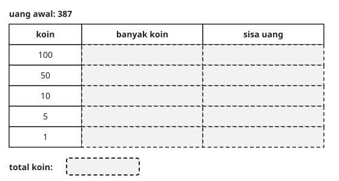

**Ingat dulu:** Tanpa melihat catatan, jawab dua soal ini.

1. Kapan sebuah cabang pencarian boleh dipangkas tanpa kehilangan jawaban? ______
2. Mengapa `fib` rekursif sederhana lambat untuk `n` besar? ______



`[Gambar: tabel dengan kolom koin, banyak koin, dan sisa uang. Baris koin berisi 100, 50, 10, 5, dan 1; uang awal 387. Kolom banyak koin dan sisa uang kosong untuk kamu isi, dan ada kotak kosong untuk total koin.]`

Tukar 387 dengan cara greedy: isi tabel dari atas ke bawah, lalu tulis total koin.

**Prediksi:** Mata uang karangan memakai koin 100, 50, 10, 5, dan 1. Fungsi selalu mengambil koin terbesar yang masih muat. Tulis tebakanmu sebelum menjalankan.

```cpp
#include <iostream>
using namespace std;

int banyakKoin(int uang) {
  int koin[5] = {100, 50, 10, 5, 1};
  int total = 0;
  for (int i = 0; i < 5; i++) {
    total += uang / koin[i];
    uang = uang % koin[i];
  }
  return total;
}

int main() {
  cout << banyakKoin(289) << " " << banyakKoin(94) << "\n";
}
```

Koin untuk 289: ______. Koin untuk 94: ______. Isi `uang` setelah koin 100 diproses pada pemanggilan pertama: ______

**Lengkapi:** Perulangan greedy yang mencetak banyak tiap koin.

```cpp setengah-jadi
for (int i = 0; i < n; i++) {
  int banyak = sisa / ____;
  sisa = sisa ____ koin[i];
  total += ____;
}
```

**Susun:** Susun baris berikut menjadi fungsi greedy yang mengembalikan banyak koin. `AI: tanpa AI`.

```text
(a)   int total = 0;
(b) int tukar(int uang, const int koin[], int n) {
(c)   return total;
(d)   for (int i = 0; i < n; i++) {
(e)   }
(f)     total += uang / koin[i]; uang %= koin[i];
```

Urutan: ______

**Latihan:**

1. `AI: boleh` Tulis pseudocode lalu program yang membaca `n`, uang, dan `n` nilai koin menurun, lalu mencetak banyak koin tiap jenis dan totalnya. Uji dengan `n = 1` (koin 1) dan dengan uang yang lebih kecil dari semua koin selain 1.

   ______

2. `AI: tanpa AI` Susun alasan satu paragraf mengapa greedy benar untuk koin 1, 2, 4, 8. Mulailah dari dua koin 1, dua koin 2, dan dua koin 4.

   ______

3. `AI: boleh` Untuk koin 5 dan 2 (urutan 5, 2), cari sebuah uang yang greedy menyatakan tak bisa dibayar pas padahal ada caranya. Uang itu: ______

**Cek diri:**

- [ ] Saya dapat menjelaskan strategi greedy dengan kata-kata sendiri.
- [ ] Saya dapat menyusun alasan sebuah greedy benar.
- [ ] Saya menyebut contoh tandingan ketika greedy salah.

**Catatan cetak (untuk guru, tidak dicetak):** dua halaman A4. Kunci ada di modul `a-xi1-m5`, bagian "Kunci dan petunjuk". Lembar tidak memuat kolom identitas.
