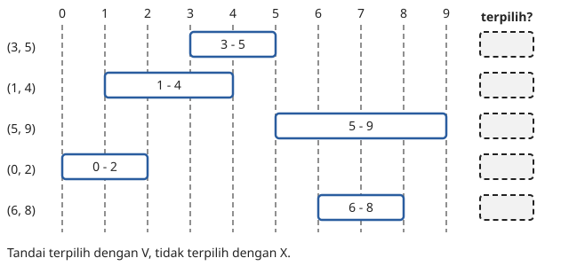

**Ingat dulu:** Tanpa melihat catatan, jawab dua soal ini.

1. Apa arti pilihan serakah, dan mengapa tidak ada percabangan seperti pada pencarian lengkap? ______
2. Mengapa pencarian lengkap selalu menghasilkan jawaban benar, dan apa harganya? ______



`[Gambar: garis waktu dengan skala 0 sampai 9. Lima batang kegiatan: (3, 5), (1, 4), (5, 9), (0, 2), dan (6, 8), masing-masing di barisnya sendiri dengan kotak kosong di ujung kanan untuk menandai terpilih atau tidak.]`

Dengan aturan "selesai paling awal dulu", tandai kegiatan yang terpilih pada kotak di ujung kanan tiap batang. Kegiatan yang mulai tepat saat yang lain selesai tidak bentrok.

**Prediksi:** Tiga kegiatan `(1, 6)`, `(5, 8)`, `(7, 12)`. Dua aturan greedy mengurutkan kegiatan, lalu memilih yang tidak bentrok dengan pilihan sebelumnya. Tulis tebakanmu sebelum menjalankan.

```cpp
#include <iostream>
#include <vector>
using namespace std;

int pilih(const vector<int>& mulai, const vector<int>& selesai, const vector<int>& kunci) {
  int n = mulai.size();
  vector<int> urut(n);
  for (int i = 0; i < n; i++) {
    urut[i] = i;
  }
  for (int i = 1; i < n; i++) {
    int x = urut[i];
    int j = i - 1;
    while (j >= 0 && kunci[urut[j]] > kunci[x]) {
      urut[j + 1] = urut[j];
      j--;
    }
    urut[j + 1] = x;
  }
  vector<int> dipilih;
  for (int t = 0; t < n; t++) {
    int a = urut[t];
    bool bentrok = false;
    for (int b : dipilih) {
      if (mulai[a] < selesai[b] && mulai[b] < selesai[a]) {
        bentrok = true;
      }
    }
    if (!bentrok) {
      dipilih.push_back(a);
    }
  }
  return dipilih.size();
}

int main() {
  vector<int> mulai = {1, 5, 7};
  vector<int> selesai = {6, 8, 12};
  vector<int> durasi = {5, 3, 5};
  cout << pilih(mulai, selesai, selesai) << " " << pilih(mulai, selesai, durasi) << "\n";
}
```

Aturan "selesai paling awal dulu" memilih ______ kegiatan; aturan "durasi terpendek dulu" memilih ______ kegiatan. Mana yang masuk akal secara intuisi, dan apakah intuisi itu cukup? ______

**Lengkapi:** Pemindaian greedy setelah kegiatan terurut menurut jam selesai.

```cpp setengah-jadi
int akhir = -1;
int banyak = 0;
for (int i = 0; i < n; i++) {
  if (mulai[i] ____ akhir) {
    banyak++;
    akhir = ____[i];
  }
}
cout << ____ << "\n";
```

**Susun:** Susun baris berikut menjadi pemindaian greedy untuk pemilihan kegiatan. `AI: tanpa AI`.

```text
(a)   int akhir = -1, banyak = 0;
(b)   for (int i = 0; i < n; i++) {
(c)     if (mulai[i] >= akhir) {
(d)       banyak++;
(e)       akhir = selesai[i];
(f)     }
(g)   }
(h)   return banyak;
```

Urutan: ______

**Latihan:**

1. `AI: tanpa AI` Buat empat kegiatan sehingga aturan "mulai paling awal dulu" memilih satu kegiatan padahal tiga kegiatan dapat dipilih.

   ______

2. `AI: boleh` Tulis pseudocode lalu program yang membaca `n` kegiatan dan mencetak banyak kegiatan maksimal. Uji dengan `n = 1`, semua bentrok, tak ada yang bentrok, dan satu pasang yang hanya bersentuhan di ujung.

   ______

3. `AI: boleh` Bandingkan greedy "selesai paling awal dulu" dengan pencarian lengkap pada seribu himpunan kecil buatan. Berapa selisih yang kamu temukan? ______

**Cek diri:**

- [ ] Saya dapat menulis greedy pemilihan kegiatan.
- [ ] Saya dapat menyebut aturan greedy yang salah dan contoh tandingannya.
- [ ] Saya memperlakukan "bentrok" dengan batas yang jelas.

**Catatan cetak (untuk guru, tidak dicetak):** dua halaman A4. Kunci ada di modul `a-xi1-m6`, bagian "Kunci dan petunjuk". Lembar tidak memuat kolom identitas.
