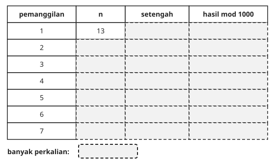

**Ingat dulu:** Tanpa melihat catatan, jawab dua soal ini.

1. Bagaimana kamu mencari contoh tandingan untuk sebuah aturan greedy? ______
2. Mengapa urutan data menurun dapat membuat pemangkasan lebih banyak? ______



`[Gambar: tabel penelusuran pangkatMod(2, 13, 1000) dengan kolom pemanggilan, n, setengah, dan hasil. Baris pertama terisi n = 13; enam baris lain kosong. Di bawah tabel ada kotak kosong untuk banyak perkalian.]`

Telusuri `pangkatMod(2, 13, 1000)`: isi tabel pemanggilan dari atas ke bawah, lalu tulis hasil dan banyak perkalian.

**Prediksi:** Fungsi menghitung `a` pangkat `n` dengan membelah `n` menjadi dua; `kali` menghitung banyak perkalian. Tulis tebakanmu sebelum menjalankan.

```cpp
#include <iostream>
using namespace std;

long long pangkat(long long a, int n, int& kali) {
  if (n == 0) {
    return 1;
  }
  long long setengah = pangkat(a, n / 2, kali);
  kali++;
  if (n % 2 == 1) {
    kali++;
    return setengah * setengah * a;
  }
  return setengah * setengah;
}

int main() {
  int kali = 0;
  cout << pangkat(2, 10, kali) << " " << kali << "\n";
  kali = 0;
  cout << pangkat(3, 13, kali) << " " << kali << "\n";
}
```

Baris pertama: ______. Baris kedua: ______. Cara biasa memerlukan `n - 1` perkalian; untuk `n = 10` itu ______ perkalian.

**Lengkapi:** Pangkat cepat untuk `a^n` (tanpa modulo).

```cpp setengah-jadi
long long pangkat(long long a, int n) {
  if (n == ____) {
    return 1;
  }
  long long setengah = pangkat(a, n / ____);
  if (n % 2 == 0) {
    return setengah * setengah;
  }
  return setengah * setengah * ____;
}
```

**Susun:** Susun baris berikut menjadi fungsi rekursif yang menjumlah `a[kiri..kanan]` dengan membelah dua. `AI: tanpa AI`.

```text
(a)   if (kiri == kanan) return a[kiri];
(b)   int tengah = (kiri + kanan) / 2;
(c) int jumlah(const int a[], int kiri, int kanan) {
(d)   int kiriJumlah = jumlah(a, kiri, tengah);
(e)   int kananJumlah = jumlah(a, tengah + 1, kanan);
(f)   return kiriJumlah + kananJumlah;
(g) }
```

Urutan: ______

**Latihan:**

1. `AI: boleh` Tulis pseudocode lalu program yang membaca `a`, `n`, `m` dan mencetak `a^n` sisa bagi `m`. Uji dengan `n = 0`, `n = 1`, dan `m = 1`.

   ______

2. `AI: boleh` Tulis fungsi `jumlah(a, kiri, kanan)` yang membelah dua seperti di soal Parsons, lalu hitung banyak pemanggilannya untuk `n = 8` dan `n = 16`. Apa polanya? ______
3. `AI: tanpa AI` Berapa kedalaman paling besar pencarian biner rekursif untuk satu juta data? Jelaskan dengan pangkat dua. ______

**Cek diri:**

- [ ] Saya dapat menyebut tiga langkah divide-and-conquer.
- [ ] Saya dapat menunjuk kasus dasar dan memastikan masalah mengecil.
- [ ] Saya menyimpan hasil submasalah di variabel, bukan menghitungnya dua kali.

**Catatan cetak (untuk guru, tidak dicetak):** dua halaman A4. Kunci ada di modul `a-xi1-m7`, bagian "Kunci dan petunjuk". Lembar tidak memuat kolom identitas.
