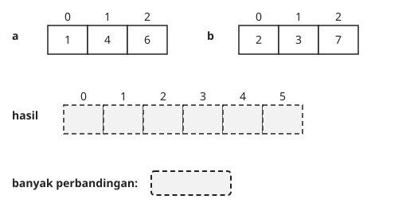

**Ingat dulu:** Tanpa melihat catatan, jawab dua soal ini.

1. Sebutkan tiga langkah divide-and-conquer dan beri satu contoh. ______
2. Pada data seperti apa insertion sort paling lambat, dan kira-kira berapa langkahnya? ______



`[Gambar: dua larik terurut, a berisi 1, 4, 6 dan b berisi 2, 3, 7, dengan indeks 0 sampai 2 di atas tiap sel. Di bawahnya larik hasil dengan enam sel kosong berindeks 0 sampai 5, dan kotak kosong untuk banyak perbandingan.]`

Gabungkan `a` dan `b` seperti fungsi `gabung`: isi larik hasil dan tulis banyak perbandingan.

**Prediksi:** Program menggabungkan dua `vector` terurut menaik. Tulis tebakanmu sebelum menjalankan.

```cpp
#include <iostream>
#include <vector>
using namespace std;

int main() {
  vector<int> a = {2, 5, 9};
  vector<int> b = {3, 4, 10};
  vector<int> hasil;
  int i = 0;
  int j = 0;
  int banding = 0;
  while (i < (int)a.size() && j < (int)b.size()) {
    banding++;
    if (a[i] <= b[j]) {
      hasil.push_back(a[i]);
      i++;
    } else {
      hasil.push_back(b[j]);
      j++;
    }
  }
  while (i < (int)a.size()) {
    hasil.push_back(a[i]);
    i++;
  }
  while (j < (int)b.size()) {
    hasil.push_back(b[j]);
    j++;
  }
  for (int x : hasil) {
    cout << x << " ";
  }
  cout << "\n";
  cout << "perbandingan: " << banding << "\n";
}
```

Isi `hasil`: ______ Banyak perbandingan: ______ Mengapa elemen `10` tidak pernah dibandingkan lagi di akhir? ______

**Lengkapi:** Pembanding yang mengurutkan kata menurut panjang menaik, lalu menurut abjad bila panjangnya sama.

```cpp setengah-jadi
bool lebihDulu(const string& a, const string& b) {
  if (a.size() != b.size()) {
    return a.size() ____ b.size();
  }
  return a ____ b;
}
```

**Susun:** Susun baris berikut menjadi badan fungsi `gabung`. `AI: tanpa AI`.

```text
(a)   while (i < a.size() && j < b.size()) {
(b)     if (a[i] <= b[j]) { hasil.push_back(a[i]); i++; }
(c)     else { hasil.push_back(b[j]); j++; }
(d)   }
(e)   int i = 0, j = 0;
(f)   while (i < a.size()) { hasil.push_back(a[i]); i++; }
(g)   while (j < b.size()) { hasil.push_back(b[j]); j++; }
(h)   vector<int> hasil;
```

Urutan: ______

**Latihan:**

1. `AI: boleh` Baca `n`, lalu `n` pasang `nama nilai`. Urutkan dengan `std::sort` menurut nilai menurun, lalu nama menaik, dan cetak. Tulis pseudocode lebih dulu.

   ______

2. `AI: boleh` Urutkan pasangan `(kode, skor)` hanya menurut skor dengan `std::stable_sort`. Apa bedanya dengan `sort` bila ada skor sama? ______
3. `AI: boleh` Untuk `n = 8`, berapa tingkat pembelahan dan berapa batas atas perbandingan merge sort `n * log2 n`? ______

**Cek diri:**

- [ ] Saya dapat menelusuri `gabung` untuk dua larik terurut.
- [ ] Saya dapat menulis pembanding dua kunci untuk `std::sort`.
- [ ] Saya menulis pseudocode sebelum programnya.

**Catatan cetak (untuk guru, tidak dicetak):** dua halaman A4. Kunci ada di modul `a-xi1-m8`, bagian "Kunci dan petunjuk". Lembar tidak memuat kolom identitas.
