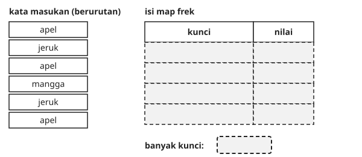

**Ingat dulu:** Tanpa melihat catatan, jawab dua soal ini.

1. Mengapa pembanding untuk `std::sort` memakai `<`, bukan `<=`? ______
2. Mengapa memilih kegiatan yang selesai paling awal tidak merugikan pilihan berikutnya? ______



`[Gambar: di kiri, urutan enam kata masukan: apel, jeruk, apel, mangga, jeruk, apel. Di kanan, tabel map frek dengan kolom kunci dan nilai, empat baris kosong, dan kotak kosong untuk banyak kunci.]`

Isi tabel `map` sesuai urutan penyimpanannya setelah semua kata dibaca. Boleh ada baris yang tidak terpakai.

**Prediksi:** Program menghitung kemunculan kata dengan `map`. Tulis tebakanmu sebelum menjalankan.

```cpp
#include <iostream>
#include <map>
#include <string>
#include <vector>
using namespace std;

int main() {
  vector<string> kata = {"apel", "jeruk", "apel", "mangga", "jeruk", "apel"};
  map<string, int> frek;
  for (const string& k : kata) {
    frek[k]++;
  }
  for (const auto& p : frek) {
    cout << p.first << ": " << p.second << "\n";
  }
  cout << "banyak kunci: " << frek.size() << "\n";
}
```

Yang tercetak: ______ Apakah urutannya sama dengan urutan kata di `vector`? ______ Mengapa? ______

**Lengkapi:** Frekuensi bilangan, dicetak dalam urutan menaik.

```cpp setengah-jadi
map<int, int> frek;
for (int i = 0; i < n; i++) {
  int x;
  cin >> x;
  frek[x]____;
}
for (auto& p : frek) {
  cout << p.____ << ": " << p.____ << "\n";
}
```

**Susun:** Susun baris berikut menjadi program yang mencetak banyak nilai berbeda, lalu nilai-nilai itu menaik. `AI: tanpa AI`.

```text
(a)   for (int y : ada) cout << y << " ";
(b)   set<int> ada;
(c)   cout << ada.size() << "\n";
(d)   int x;
(e)   for (int i = 0; i < n; i++) {
(f)     cin >> x;
(g)     ada.insert(x);
(h)   }
```

Urutan: ______

**Latihan:**

1. `AI: tanpa AI` Pada `map<string, int> m;` dijalankan `m["a"];` lalu `m["b"] = 2;`. Berapa `m.size()`? ______ Lalu `m.count("c")` bernilai ______, dan `m.size()` setelah `m["c"];` bernilai ______.
2. `AI: boleh` Baca `n` kata. Cetak tiap kata beserta jumlahnya, dari yang paling sering; bila sama, menurut abjad. Tulis pseudocode lebih dulu.

   ______

3. `AI: boleh` Baca `n` bilangan dan cetak tiap bilangan hanya pada kemunculan pertamanya, dengan urutan asli.

   ______

**Cek diri:**

- [ ] Saya dapat menghitung frekuensi dengan `map`.
- [ ] Saya tahu `m[k]` membuat entri bila kunci belum ada.
- [ ] Saya dapat membuang duplikat dengan `set`.

**Catatan cetak (untuk guru, tidak dicetak):** dua halaman A4. Kunci ada di modul `a-xi1-m9`, bagian "Kunci dan petunjuk". Lembar tidak memuat kolom identitas.
