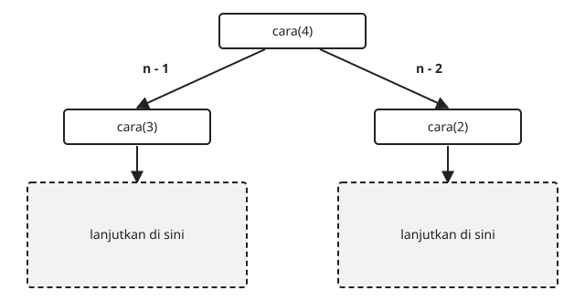

**Ingat dulu:** Tanpa melihat catatan, jawab dua soal ini.

1. Mengapa pencarian lengkap lambat untuk `T` besar, dan apa yang membuat tabel DP lebih cepat? ______
2. Apa beda divide-and-conquer dengan rekursi yang hanya mengurangi `n` satu per satu? ______



`[Gambar: pohon pemanggilan cara(4) dengan pangkal n = 4. Dua anak di tingkat pertama: cabang "n - 1" ke n = 3 dan cabang "n - 2" ke n = 2. Bagian di bawahnya area kosong bergaris putus-putus untuk kamu lanjutkan sampai n <= 1.]`

Lanjutkan pohon sampai kasus dasar, lalu lingkari pemanggilan yang sama persis dengan pemanggilan lain.

**Prediksi:** Tangga dengan `n` anak tangga; sekali melangkah naik satu atau dua anak tangga. `cara(n)` menghitung banyak urutan langkah, dan `panggilan` menghitung berapa kali fungsi dipanggil. Tulis tebakanmu sebelum menjalankan.

```cpp
#include <iostream>
using namespace std;

long long panggilan = 0;

long long cara(int n) {
  panggilan++;
  if (n <= 1) {
    return 1;
  }
  return cara(n - 1) + cara(n - 2);
}

int main() {
  cout << "cara(4) = " << cara(4) << "\n";
  cout << "panggilan = " << panggilan << "\n";
}
```

`cara(4)` = ______. Berapa kali `cara(2)` dipanggil? ______ Tebakan kasar banyak `panggilan`: ______

**Lengkapi:** Tangga yang sama, tetapi sekali melangkah boleh naik 1, 2, atau 3 anak tangga. Lengkapi memoisasinya.

```cpp setengah-jadi
long long cara3(int n, vector<long long>& memo) {
  if (n < 0) {
    return ____;
  }
  if (n == 0) {
    return 1;
  }
  if (memo[n] != -1) {
    return ____;
  }
  memo[n] = cara3(n - 1, memo) + cara3(n - 2, memo) + cara3(n - ____, memo);
  return memo[n];
}
```

**Susun:** Susun baris berikut menjadi fungsi `cara` dengan memoisasi. `AI: tanpa AI`.

```text
(a)   if (n <= 1) return 1;
(b)   if (memo[n] != -1) return memo[n];
(c) long long cara(int n, vector<long long>& memo) {
(d)   memo[n] = cara(n - 1, memo) + cara(n - 2, memo);
(e)   return memo[n];
(f) }
```

Urutan: ______

**Latihan:**

1. `AI: tanpa AI` Tangga punya 6 anak tangga dan anak tangga ke-3 rusak (tidak boleh diinjak). Isi tabel `dp` dengan tangan.

   | anak tangga | 0 | 1 | 2 | 3 | 4 | 5 | 6 |
   | --- | --- | --- | --- | --- | --- | --- | --- |
   | `dp` | | | | | | | |

   Berapa cara mencapai anak tangga ke-6? ______

2. `AI: boleh` Tulis pseudocode lebih dulu, lalu program yang membaca `t`, kemudian `t` bilangan `n` (0 sampai 80), dan mencetak `cara(n)` memakai tabel. Mengapa `n = 0` dan `n = 80` perlu diuji? ______
3. `AI: boleh` Untuk `n = 60`, `cara(60)` kira-kira `2,5 * 10^12`. Dengan pedoman seratus juta langkah per detik, berapa lama kira-kira `murni(60)`? ______

**Cek diri:**

- [ ] Saya dapat menunjukkan submasalah yang dihitung berulang pada pohon pemanggilan.
- [ ] Saya dapat menulis rumus peralihan sebuah masalah DP.
- [ ] Saya dapat menambahkan memoisasi pada rekursi.

**Catatan cetak (untuk guru, tidak dicetak):** dua halaman A4. Kunci ada di modul `a-xi2-m1`, bagian "Kunci dan petunjuk". Lembar tidak memuat kolom identitas.
