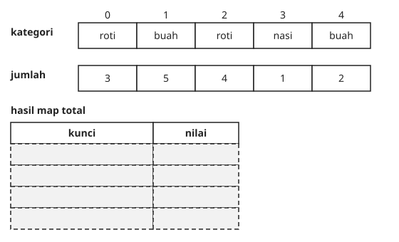

**Ingat dulu:** Tanpa melihat catatan, jawab dua soal ini.

1. Berapa kolom yang dikembalikan `getline(ss, bagian, ',')` secara berulang untuk `a,,c` dan untuk `a,b,`? ______
2. Apa beda urutan kunjungan BFS dan DFS pada graf yang sama? ______



`[Gambar: dua larik lima sel dengan indeks 0 sampai 4. Larik kategori berisi roti, buah, roti, nasi, buah; larik jumlah berisi 3, 5, 4, 1, 2. Di bawahnya tabel hasil map total dengan kolom kunci dan nilai, empat baris kosong.]`

Isi tabel hasil `map` total sesuai urutan tersimpannya setelah program di bawah selesai. Boleh ada baris yang tidak terpakai.

**Prediksi:** Kelompok dibuat dengan menambahkan ke `map` menurut kunci. Tulis tebakanmu sebelum menjalankan.

```cpp
#include <iostream>
#include <map>
#include <string>
using namespace std;

int main() {
  string kategori[5] = {"roti", "buah", "roti", "nasi", "buah"};
  int jumlah[5] = {3, 5, 4, 1, 2};
  map<string, int> total;
  for (int i = 0; i < 5; i++) {
    total[kategori[i]] += jumlah[i];
  }
  for (const auto& p : total) {
    cout << p.first << ": " << p.second << "\n";
  }
}
```

Yang tercetak: ______ Apakah kamu perlu mengurutkan data lebih dulu agar kelompoknya terbentuk? ______

**Lengkapi:** Banyak kemunculan tiap kategori dari `vector<string> kat`.

```cpp setengah-jadi
map<string, int> hitung;
for (const string& k : ____) {
  hitung[k]____;
}
for (const auto& p : hitung) {
  cout << p.____ << " " << p.second << "\n";
}
```

**Susun:** Susun baris berikut menjadi potongan yang menjumlahkan nilai per kunci, lalu mencetak. `AI: tanpa AI`.

```text
(a)   map<string, long long> jumlah;
(b)   for (int i = 0; i < n; i++) {
(c)     jumlah[kunci[i]] += nilai[i];
(d)   }
(e)   for (const auto& p : jumlah) {
(f)     cout << p.first << " " << p.second << "\n";
(g)   }
(h)   // kunci dan nilai sudah terisi sebanyak n
```

Urutan: ______

**Latihan:**

1. `AI: tanpa AI` Pada `map<string, int> m;` dijalankan `m["a"] += 2; m["b"] += 1; m["a"] += 3;`. Isi `m`: ______ `size()`: ______
2. `AI: boleh` Pada `data.csv` contoh, cetak jumlah per `bulan`, bukan per kategori. Tulis pseudocode dulu; apa yang berubah dari program rekap? ______
3. `AI: boleh` Tambahkan nilai terkecil per kategori. Apa nilai awal yang aman untuk `terkecil`? ______

**Cek diri:**

- [ ] Saya dapat mengelompokkan data dengan `map` tanpa mengurutkannya.
- [ ] Saya dapat merekap banyak, jumlah, rata-rata, dan terbesar per kelompok.
- [ ] Saya dapat menyebut banyak langkah merekap `n` baris ke `k` kelompok.

**Catatan cetak (untuk guru, tidak dicetak):** dua halaman A4. Kunci ada di modul `a-xi2-m10`, bagian "Kunci dan petunjuk". Lembar tidak memuat kolom identitas.
