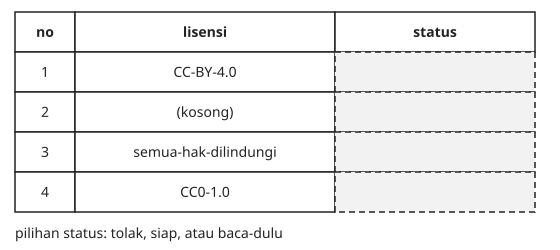

**Ingat dulu:** Tanpa melihat catatan, jawab dua soal ini.

1. Mengapa `map` bisa mengelompokkan data tanpa mengurutkannya lebih dulu, dan terurut menurut apa isinya? ______
2. Mengapa DP knapsack tidak layak bila `W = 10^12` meskipun `n` kecil, dan strategi apa yang masih mungkin? ______



`[Gambar: tabel dengan kolom nomor, lisensi, dan status. Empat baris: 1 CC-BY-4.0; 2 lisensi kosong; 3 semua-hak-dilindungi; 4 CC0-1.0. Kolom status kosong untuk kamu isi dengan tolak, siap, atau baca-dulu.]`

Isi kolom status dengan menelusuri fungsi `status` di bawah.

**Prediksi:** Fungsi menyaring teks lisensi pada catatan sumber. Tulis tebakanmu sebelum menjalankan.

```cpp
#include <iostream>
#include <string>
using namespace std;

string status(const string& lisensi) {
  if (lisensi.empty() || lisensi == "tidak-tertulis") {
    return "tolak";
  }
  if (lisensi == "CC0-1.0" || lisensi == "CC-BY-4.0") {
    return "siap";
  }
  return "baca-dulu";
}

int main() {
  string contoh[4] = {"CC-BY-4.0", "", "semua-hak-dilindungi", "CC0-1.0"};
  for (int i = 0; i < 4; i++) {
    cout << i + 1 << ": " << status(contoh[i]) << "\n";
  }
}
```

Mengapa lisensi yang kosong ditolak, bukan dianggap bebas? ______

**Lengkapi:** Fungsi yang menyatakan apakah sebuah dataset wajib diberi atribusi menurut lisensinya.

```cpp setengah-jadi
bool wajibAtribusi(const string& lisensi) {
  if (lisensi == "____") {
    return true;
  }
  if (lisensi == "CC0-1.0") {
    return ____;
  }
  return ____;
}
```

**Susun:** Susun langkah berikut menjadi prosedur menilai satu dataset terbuka sebelum dipakai. `AI: tanpa AI`.

```text
(a)   Catat nama, penerbit, tanggal akses, dan tautan sumber.
(b)   Temukan dataset yang kamu butuhkan.
(c)   Putuskan: pakai, baca lebih dulu, atau tolak.
(d)   Baca lisensi pada halaman resmi dataset itu.
(e)   Periksa definisi kolom, cara pengumpulan, dan tanggal pembaruan.
(f)   Pastikan tidak ada data pribadi orang nyata.
(g)   Bila dipakai, tulis atribusi dan catat bila datanya kamu ubah.
(h)   Simpan catatan sumber bersama programmu.
```

Urutan: ______

**Latihan:**

1. `AI: tanpa AI` Kamu memakai data CC BY 4.0, membuang tiga kolomnya, dan menjumlahkan per kategori. Apa yang wajib kamu tulis pada laporanmu? ______
2. `AI: tanpa AI` Sebuah situs menampilkan tabel harga tanpa keterangan lisensi dan tanpa penerbit. Bolehkah kamu memakainya untuk proyek? Beri dua alasan. ______
3. `AI: boleh` Buat tiga baris catatan sumber untuk data karanganmu sendiri. Tentukan lisensinya sendiri dan tulis alasannya.

   ______

**Cek diri:**

- [ ] Saya dapat menulis atribusi untuk data berlisensi CC BY 4.0.
- [ ] Saya menolak data yang lisensinya tidak jelas atau berisi data pribadi.
- [ ] Saya menyimpan catatan sumber bersama programku.

**Catatan cetak (untuk guru, tidak dicetak):** dua halaman A4. Kunci ada di modul `a-xi2-m11`, bagian "Kunci dan petunjuk". Lembar tidak memuat kolom identitas.
