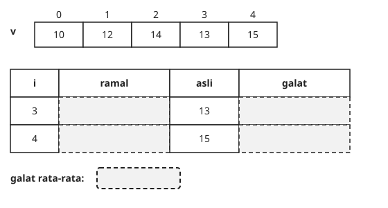

**Ingat dulu:** Tanpa melihat catatan, jawab dua soal ini.

1. Apa saja yang perlu ada dalam catatan sumber sebuah dataset? ______
2. Mengapa data dari luar divalidasi baris demi baris, dan apa yang dicatat untuk baris yang ditolak? ______



`[Gambar: deret v berindeks 0 sampai 4 berisi 10, 12, 14, 13, 15. Di bawahnya tabel dengan kolom i, ramal, asli, dan galat untuk dua baris, i = 3 dan i = 4. Kolom i terisi, kolom asli terisi dari deret, kolom ramal dan galat kosong, dan kotak kosong untuk galat rata-rata.]`

Isi tabel dengan tangan memakai prediksi rata-rata tiga nilai tepat sebelumnya. Galat adalah selisih mutlak dengan nilai sebenarnya.

**Prediksi:** Tulis tebakanmu sebelum menjalankan.

```cpp
#include <cmath>
#include <iostream>
using namespace std;

int main() {
  double v[5] = {10, 12, 14, 13, 15};
  int k = 3;
  double jumlahGalat = 0;
  for (int i = k; i < 5; i++) {
    double ramal = (v[i - 1] + v[i - 2] + v[i - 3]) / 3.0;
    double galat = fabs(ramal - v[i]);
    cout << "i=" << i << " ramal " << ramal << " asli " << v[i] << " galat " << galat << "\n";
    jumlahGalat += galat;
  }
  cout << "galat rata-rata " << jumlahGalat / (5 - k) << "\n";
}
```

Yang tercetak pada tiap baris: ______ Prediksi nilai ke-6 dengan cara yang sama: ______

**Lengkapi:** Galat rata-rata mutlak dua deretan yang sama panjang.

```cpp setengah-jadi
double galatRata(const vector<double>& asli, const vector<double>& ramal) {
  double jumlah = 0;
  for (int i = 0; i < (int)____.size(); i++) {
    jumlah += fabs(asli[i] - ____[i]);
  }
  return jumlah / ____.size();
}
```

**Susun:** Susun baris berikut menjadi fungsi rata-rata bergerak dari `v[hingga - k]` sampai `v[hingga - 1]`. `AI: tanpa AI`.

```text
(a)   double rataBergerak(const vector<double>& v, int hingga, int k) {
(b)     double jumlah = 0;
(c)     for (int i = hingga - k; i < hingga; i++) {
(d)       jumlah += v[i];
(e)     }
(f)     return jumlah / k;
(g)   }
(h)   // hingga adalah indeks yang akan diprediksi
```

Urutan: ______

**Latihan:**

1. `AI: tanpa AI` Deretan `2 4 6 8`: berapa prediksi garis kecenderungan untuk nilai berikutnya? ______ Berapa prediksi rata-rata bergerak `k = 2`? ______
2. `AI: boleh` Buat 10 angka sintetis yang naik turun tanpa arah. Cara mana yang lebih baik, dan apakah sama dengan data naik di contoh? ______
3. `AI: boleh` Program contoh gagal bila `n` kurang dari 5. Tambahkan pemeriksaan agar program melapor "data terlalu sedikit" dan tidak membagi dengan nol.

   ______

**Cek diri:**

- [ ] Saya dapat menghitung rata-rata bergerak dari `k` nilai terakhir.
- [ ] Saya dapat menghitung galat rata-rata mutlak pada data uji.
- [ ] Saya dapat menyebut keterbatasan prediksi sederhana.

**Catatan cetak (untuk guru, tidak dicetak):** dua halaman A4. Kunci ada di modul `a-xi2-m12`, bagian "Kunci dan petunjuk". Lembar tidak memuat kolom identitas.
