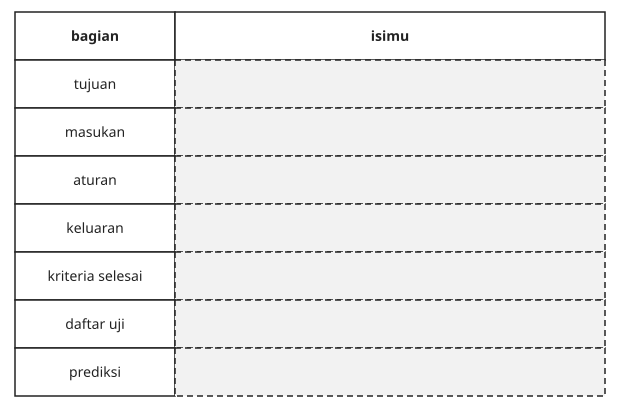

**Ingat dulu:** Tanpa melihat catatan, jawab tiga soal ini.

1. Mengapa prediksi dinilai dengan data yang tidak dipakai untuk membuatnya? ______
2. Kira-kira berapa langkah merekap `n` baris ke `k` kelompok dengan `map`? ______
3. Kira-kira berapa entri daftar ketetanggaan untuk 100.000 simpul dan 200.000 sisi tak berarah, dan mengapa matriksnya tak muat? ______

`[Gambar: tabel dua kolom, bagian dan isimu. Tujuh baris bagian: tujuan, masukan, aturan, keluaran, kriteria selesai, daftar uji, dan prediksi. Kolom isimu kosong untuk kamu tulis.]`

Tulis rencana proyek analisis data terbukamu pada tabel: mulailah dari pertanyaan keputusan, bukan dari alat. Gunakan data sintetis atau berlisensi, tanpa data orang nyata.

**Latihan:**

1. `AI: tanpa AI` Mengapa lisensi dan atribusi masuk laporan, bukan hanya program? ______
2. `AI: boleh` Tambahkan pencatat banyak baris ditolak per alasan: kolom salah atau bukan angka.

   ______

3. `AI: tanpa AI` Umpan balik sejawat dalam tiga kalimat tentang pekerjaan, bukan orangnya: satu yang sudah baik (tunjuk bagiannya), satu yang perlu diperbaiki (beri alasan), dan satu langkah berikutnya.

   ______

**Cek diri:**

- [ ] Saya dapat menyebut pertanyaan keputusan, sumber, dan kriteria selesai proyek saya.
- [ ] Saya menulis pseudocode sebelum program.
- [ ] Saya mencatat sumber, lisensi, dan baris yang ditolak.

**Catatan cetak (untuk guru, tidak dicetak):** satu halaman A4. Kunci ada di modul `a-xi2-m13`, bagian "Kunci dan petunjuk". Bagian Prediksi, Lengkapi, dan Susun dilewati karena modul proyek ini tidak memuatnya. Lembar tidak memuat kolom identitas.
