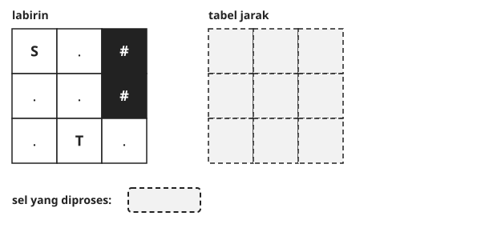

**Ingat dulu:** Tanpa melihat catatan, jawab tiga soal ini.

1. Mengapa data terbuka tetap dicek sebelum dianalisis, dan apa yang dicatat tentang baris rusak? ______
2. Berapa langkah BFS pada graf dengan `n` simpul dan `m` sisi bila memakai daftar ketetanggaan? ______
3. Apa yang disimpan sebuah tabel DP satu dimensi, dan apa yang menentukan urutan mengisinya? ______



`[Gambar: grid tiga baris dan tiga kolom, baris 0: S . #, baris 1: . . #, baris 2: . T . Sel dinding gelap bertanda #. Di bawahnya tabel jarak 3 kali 3 yang kosong dan kotak kosong untuk banyak sel yang diproses.]`

Pakai gambar untuk nomor 1 di bagian Latihan: isi tabel jarak dengan BFS dari `S` (tulis X di sel dinding atau yang tak terjangkau).

**Latihan:** Kerjakan sendiri, `AI: tanpa AI`, dengan waktu yang ditetapkan gurumu.

1. Program berikut dijalankan. Apa yang tercetak, dan mengapa jumlah sel yang diproses bukan 9?

   ```cpp
   #include <iostream>
   #include <queue>
   #include <string>
   #include <utility>
   using namespace std;

   int main() {
     string g[3] = {"S.#", "..#", ".T."};
     int jarak[3][3];
     for (int i = 0; i < 3; i++) {
       for (int j = 0; j < 3; j++) {
         jarak[i][j] = -1;
       }
     }
     int dx[4] = {-1, 1, 0, 0};
     int dy[4] = {0, 0, -1, 1};
     queue<pair<int, int>> q;
     q.push({0, 0});
     jarak[0][0] = 0;
     int diproses = 0;
     while (!q.empty()) {
       pair<int, int> p = q.front();
       q.pop();
       diproses++;
       for (int k = 0; k < 4; k++) {
         int a = p.first + dx[k];
         int b = p.second + dy[k];
         if (a < 0 || a >= 3 || b < 0 || b >= 3) {
           continue;
         }
         if (g[a][b] != '#' && jarak[a][b] == -1) {
           jarak[a][b] = jarak[p.first][p.second] + 1;
           q.push({a, b});
         }
       }
     }
     cout << jarak[2][1] << " " << diproses << "\n";
   }
   ```

   Tercetak: ______ Alasannya: ______

2. Tulis pseudocode lalu program: baca CSV `ruang,nilai` dengan satu baris judul. Tolak baris yang bukan dua kolom atau nilainya bukan angka dan hitung. Cetak jumlah tiap ruang (terurut menurut nama ruang) dan ruang dengan jumlah terbesar. Pakai `map`.

   ______

3. Tiga potongan berikut sengaja salah. Untuk tiap potongan tulis galatnya, akibatnya, dan perbaikannya.

   ```text
   (a) if (g[a][b] == '.' && a >= 0 && a < R) { ... }
   (b) rata = jumlah / k;     // jumlah dan k bertipe int
   (c) cocokkan garis pada seluruh 12 bulan, lalu hitung galatnya pada 12 bulan yang sama
   ```

   (a) ______ (b) ______ (c) ______

**Cek diri:**

- [ ] Saya dapat menelusuri BFS pada grid dan menyebut banyak langkahnya.
- [ ] Saya dapat membaca CSV, menolak baris rusak, dan merekap dengan `map`.
- [ ] Saya dapat mengompilasi dan menguji programku dengan nilai batas.

**Catatan cetak (untuk guru, tidak dicetak):** dua halaman A4. Kunci ada di modul `a-xi2-m14`, bagian "Kunci dan petunjuk". Bagian Prediksi, Lengkapi, dan Susun dilewati karena modul asesmen ini tidak memuatnya. Lembar tidak memuat kolom identitas.
