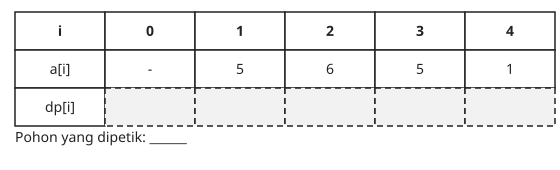

**Ingat dulu:** Tanpa melihat catatan, jawab dua soal ini.

1. Apa dua ciri masalah yang cocok diselesaikan dengan DP? ______
2. Mengapa merge sort memerlukan larik bantu, dan apa akibatnya pada pemakaian memori? ______



`[Gambar: tabel dengan kolom indeks i = 0 sampai 4. Baris a[i] berisi sel kosong untuk i = 0 dan 5, 6, 5, 1 untuk i = 1 sampai 4. Baris dp[i] kosong seluruhnya. Dua pohon bersebelahan tidak boleh dipetik bersama.]`

Isi baris `dp[i]` dengan tangan memakai `dp[i] = max(dp[i - 1], dp[i - 2] + a[i])`, lalu tulis pohon mana yang dipetik.

**Prediksi:** Kebun karangan, empat pohon berderet berisi 5, 6, 5, dan 1 buah. Dua pohon yang bersebelahan tidak boleh dipetik bersama. Program memilih pohon terbanyak yang masih boleh, berulang kali. Tulis tebakanmu sebelum menjalankan.

```cpp
#include <iostream>
#include <vector>
using namespace std;

int main() {
  vector<int> a = {5, 6, 5, 1};
  int n = a.size();
  vector<bool> boleh(n, true);
  int total = 0;
  while (true) {
    int terbaik = -1;
    for (int i = 0; i < n; i++) {
      if (boleh[i] && (terbaik == -1 || a[i] > a[terbaik])) {
        terbaik = i;
      }
    }
    if (terbaik == -1) {
      break;
    }
    total += a[terbaik];
    boleh[terbaik] = false;
    if (terbaik > 0) {
      boleh[terbaik - 1] = false;
    }
    if (terbaik + 1 < n) {
      boleh[terbaik + 1] = false;
    }
  }
  cout << "total " << total << "\n";
}
```

Tercetak: ______ Adakah cara memetik dengan total lebih banyak? ______ Pohon mana saja? ______

**Lengkapi:** Tangga dengan biaya menginjak tiap anak tangga. Mulai dari tanah (biaya 0), naik 1 atau 2 anak tangga sekali melangkah, dan harus menginjak anak tangga `n`. Cari biaya terkecil.

```cpp setengah-jadi
vector<int> dp(n + 1, 0);
dp[0] = ____;
dp[1] = ____;
for (int i = 2; i <= n; i++) {
  dp[i] = biaya[i] + min(dp[i - 1], ____);
}
cout << dp[n] << "\n";
```

**Susun:** Susun baris berikut menjadi program total terbanyak pemetik buah. `AI: tanpa AI`.

```text
(a)   dp[i] = max(dp[i - 1], dp[i - 2] + a[i]);
(b) dp[0] = 0;
(c) cout << dp[n] << "\n";
(d) for (int i = 2; i <= n; i++) {
(e) }
(f) dp[1] = a[1];
```

Urutan: ______

**Latihan:**

1. `AI: boleh` Tulis pseudocode lebih dulu, lalu program yang membaca `n` dan `n` bilangan lalu mencetak total terbanyak. Uji `n = 0`, `n = 1`, `n = 2`, dan semua bilangan 0. Mengapa `n = 0` perlu penjagaan sendiri? ______
2. `AI: boleh` Diberikan `n` bilangan, cari panjang barisan bagian (tidak harus bersebelahan) yang naik tegas, dengan `dp[i]` = panjang terpanjang yang berakhir di `i`. Berapa langkahnya? ______
3. `AI: boleh` Tulis versi pemetik yang memakai dua variabel saja. Mengapa versi ini tak dapat mencetak pilihan? ______

**Cek diri:**

- [ ] Saya dapat menulis arti `dp[i]`, nilai awal, dan rumus peralihan.
- [ ] Saya dapat mengisi tabel dan menelusurinya dengan tangan.
- [ ] Saya dapat menguji DP dengan pencarian lengkap pada data kecil.

**Catatan cetak (untuk guru, tidak dicetak):** dua halaman A4. Kunci ada di modul `a-xi2-m2`, bagian "Kunci dan petunjuk". Lembar tidak memuat kolom identitas.
