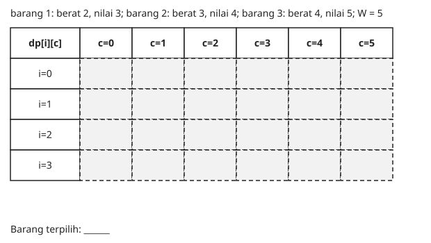

**Ingat dulu:** Tanpa melihat catatan, jawab dua soal ini.

1. Apa tiga hal yang perlu ditentukan saat merumuskan DP satu dimensi? ______
2. Berapa banyak himpunan bagian dari `n` unsur, dan mengapa itu membatasi `n` pada pencarian lengkap? ______



`[Gambar: daftar tiga barang: barang 1 berat 2 nilai 3, barang 2 berat 3 nilai 4, barang 3 berat 4 nilai 5, dengan kapasitas W = 5. Di bawahnya tabel dp[i][c] dengan baris i = 0 sampai 3 dan kolom c = 0 sampai 5, semua sel kosong.]`

Isi tabel `dp[i][c]` baris demi baris dengan tangan. Lingkari barang yang terpilih.

**Prediksi:** Satu barang karangan: berat 2, nilai 3, kapasitas tas 6, hanya boleh diambil sekali. Dua perulangan mengisi tabel satu dimensi, satu dengan kapasitas menaik dan satu menurun. Tulis tebakanmu sebelum menjalankan.

```cpp
#include <algorithm>
#include <iostream>
#include <vector>
using namespace std;

int main() {
  int W = 6;
  int berat = 2;
  int nilai = 3;
  vector<int> naik(W + 1, 0);
  vector<int> turun(W + 1, 0);
  for (int c = berat; c <= W; c++) {
    naik[c] = max(naik[c], naik[c - berat] + nilai);
  }
  for (int c = W; c >= berat; c--) {
    turun[c] = max(turun[c], turun[c - berat] + nilai);
  }
  cout << "naik " << naik[W] << ", turun " << turun[W] << "\n";
}
```

Tercetak: ______ Mana yang benar untuk satu barang? ______ Mengapa yang lain keliru? ______

**Lengkapi:** Knapsack satu dimensi untuk tiga barang di gambar.

```cpp setengah-jadi
vector<int> dp(W + 1, 0);
for (int i = 1; i <= n; i++) {
  for (int c = ____; c >= berat[i]; c--) {
    dp[c] = max(dp[c], dp[c - ____] + nilai[i]);
  }
}
cout << dp[____] << "\n";
```

**Susun:** Susun baris berikut menjadi knapsack satu dimensi. `AI: tanpa AI`.

```text
(a)     for (int c = W; c >= berat[i]; c--) {
(b)       dp[c] = max(dp[c], dp[c - berat[i]] + nilai[i]);
(c) vector<int> dp(W + 1, 0);
(d) for (int i = 1; i <= n; i++) {
(e)     }
(f)   }
(g) cout << dp[W] << "\n";
```

Urutan: ______

**Latihan:**

1. `AI: boleh` Tulis pseudocode lebih dulu, lalu program satu dimensi yang membaca `n`, `W`, dan `n` pasang berat dan nilai, lalu mencetak nilai terbaik. Uji `W = 0`, barang yang lebih berat dari `W`, dan semua barang muat.

   ______

2. `AI: tanpa AI` Pilih pencarian lengkap, DP, atau tak satu pun, dengan perkiraan langkah: (a) `n = 20`, `W = 10^9` ______; (b) `n = 1000`, `W = 10^4` ______; (c) `n = 1000`, `W = 10^12` ______.
3. `AI: boleh` Diberikan `n` bilangan positif dan beberapa pertanyaan `S`, tentukan apakah ada himpunan bagian yang jumlahnya tepat `S`. Pakai `bisa[c]` bernilai benar atau salah dan perulangan menurun.

   ______

**Cek diri:**

- [ ] Saya dapat mengisi tabel dan mencetak barang terpilih.
- [ ] Saya dapat menjelaskan mengapa kapasitas diulang menurun.
- [ ] Saya dapat menyebut langkah dan memori `n * W`.

**Catatan cetak (untuk guru, tidak dicetak):** dua halaman A4. Kunci ada di modul `a-xi2-m3`, bagian "Kunci dan petunjuk". Lembar tidak memuat kolom identitas.
