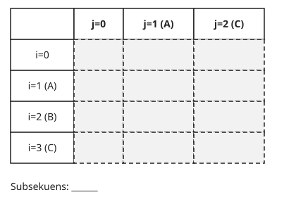

**Ingat dulu:** Tanpa melihat catatan, jawab dua soal ini.

1. Mengapa pada knapsack 0/1 satu dimensi kapasitas harus diulang dari besar ke kecil? ______
2. Apa beda memoisasi dan tabel, dan mengapa penanda "belum dihitung" tidak boleh nilai yang mungkin menjadi jawaban? ______



`[Gambar: tabel dp[i][j] dengan baris untuk s = "ABC" (i = 0 sampai 3, tiap baris diberi huruf s[i]) dan kolom untuk t = "AC" (j = 0 sampai 2, tiap kolom diberi huruf t[j]). Semua sel kosong.]`

Isi tabel dengan tangan memakai peralihan LCS, lalu tulis panjang dan satu subsekuens persekutuan terpanjang.

**Prediksi:** Subsekuens diperoleh dengan menghapus beberapa huruf tanpa mengubah urutan sisanya. Program menghitung panjang subsekuens persekutuan terpanjang dua kata karangan. Tulis tebakanmu sebelum menjalankan.

```cpp
#include <algorithm>
#include <iostream>
#include <string>
#include <vector>
using namespace std;

int main() {
  string s = "ACBAD";
  string t = "ABAZD";
  int m = s.size();
  int n = t.size();
  vector<vector<int>> dp(m + 1, vector<int>(n + 1, 0));
  for (int i = 1; i <= m; i++) {
    for (int j = 1; j <= n; j++) {
      if (s[i - 1] == t[j - 1]) {
        dp[i][j] = dp[i - 1][j - 1] + 1;
      } else {
        dp[i][j] = max(dp[i - 1][j], dp[i][j - 1]);
      }
    }
  }
  cout << "panjang " << dp[m][n] << "\n";
}
```

Tercetak: ______ Satu subsekuens yang kamu temukan: ______ Apakah subsekuens itu juga substring dari kedua kata? ______

**Lengkapi:** Peralihan tabel untuk `s = "ACBAD"` dan `t = "ABAZD"`.

```cpp setengah-jadi
for (int i = 1; i <= m; i++) {
  for (int j = 1; j <= n; j++) {
    if (s[i - 1] == t[j - 1]) {
      dp[i][j] = dp[____][____] + 1;
    } else {
      dp[i][j] = max(dp[i - 1][j], dp[i][____]);
    }
  }
}
```

**Susun:** Susun baris berikut (sudah diacak, tanpa lekuk) menjadi pengisian tabel. `AI: tanpa AI`.

```text
(a) dp[i][j] = max(dp[i - 1][j], dp[i][j - 1]);
(b) for (int i = 1; i <= m; i++) {
(c) if (s[i - 1] == t[j - 1]) {
(d) } else {
(e) for (int j = 1; j <= n; j++) {
(f) dp[i][j] = dp[i - 1][j - 1] + 1;
(g) }
(h) }
(i) }
```

Urutan: ______

**Latihan:**

1. `AI: boleh` Tulis pseudocode lebih dulu, lalu program yang membaca dua kata dan mencetak panjang subsekuens persekutuan terpanjangnya. Uji dua kata yang sama, dua kata tanpa huruf yang sama, dan kata satu huruf.

   ______

2. `AI: boleh` Cari panjang substring persekutuan terpanjang. Bila huruf sama, `dp[i][j] = dp[i - 1][j - 1] + 1`; bila beda, `dp[i][j] = 0`. Jawabannya nilai terbesar di seluruh tabel. Uji `"ABABC"` dan `"BABCA"`. Hasilnya: ______
3. `AI: boleh` Berapa huruf paling sedikit yang harus dihapus dari kedua kata agar keduanya menjadi kata yang sama? Pakai panjang LCS. ______

**Cek diri:**

- [ ] Saya dapat membedakan subsekuens dan substring.
- [ ] Saya dapat mengisi tabel dan mencetak satu subsekuens.
- [ ] Saya dapat menjelaskan mengapa tabel diisi dari kecil ke besar.

**Catatan cetak (untuk guru, tidak dicetak):** dua halaman A4. Kunci ada di modul `a-xi2-m4`, bagian "Kunci dan petunjuk". Lembar tidak memuat kolom identitas.
