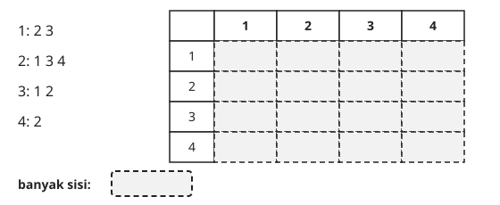

**Ingat dulu:** Tanpa melihat catatan, jawab dua soal ini.

1. Apa beda subsekuens dan substring? ______
2. Apa yang dilakukan `push_back` dan `pop_back`? ______



`[Gambar: di kiri daftar ketetanggaan: 1: 2 3; 2: 1 3 4; 3: 1 2; 4: 2. Di kanan matriks 4 kali 4 dengan judul baris dan kolom 1 sampai 4, semua sel kosong, dan kotak kosong untuk banyak sisi.]`

Isi matriks ketetanggaan (1 bila ada sisi, 0 bila tidak). Lalu hitung banyak sisi dari jumlah derajat dan gambarlah grafnya di kertas.

**Prediksi:** Graf adalah kumpulan **simpul** yang dihubungkan **sisi**. Lima desa karangan bernomor 1 sampai 5 dan empat jalan dua arah. Daftar `adj[i]` menyimpan tetangga desa `i`. Tulis tebakanmu sebelum menjalankan.

```cpp
#include <iostream>
#include <vector>
using namespace std;

int main() {
  vector<vector<int>> adj(6);
  int sisi[4][2] = {{1, 2}, {1, 3}, {2, 3}, {4, 5}};
  for (int k = 0; k < 4; k++) {
    int u = sisi[k][0];
    int v = sisi[k][1];
    adj[u].push_back(v);
    adj[v].push_back(u);
  }
  int jumlah = 0;
  for (int i = 1; i <= 5; i++) {
    cout << "desa " << i << ": " << adj[i].size() << " tetangga\n";
    jumlah += adj[i].size();
  }
  cout << "jumlah " << jumlah << "\n";
}
```

| desa | 1 | 2 | 3 | 4 | 5 |
| --- | --- | --- | --- | --- | --- |
| tetangga | | | | | |

`jumlah` = ______ Hubungannya dengan empat sisi: ______

**Lengkapi:** Pembacaan sisi tak berarah ke daftar ketetanggaan.

```cpp setengah-jadi
for (int k = 0; k < m; k++) {
  int u;
  int v;
  cin >> u >> v;
  adj[u].push_back(____);
  adj[____].push_back(u);
}
```

**Susun:** Susun baris berikut (sudah diacak, tanpa lekuk) menjadi pembacaan graf. `AI: tanpa AI`.

```text
(a) cin >> n >> m;
(b) adj[u].push_back(v);
(c) for (int k = 0; k < m; k++) {
(d) vector<vector<int>> adj(n + 1);
(e) adj[v].push_back(u);
(f) cin >> u >> v;
(g) }
```

Urutan: ______

**Latihan:**

1. `AI: boleh` Tulis pseudocode lalu program yang membaca graf tak berarah, mencetak derajat tiap simpul, dan mencetak simpul berderajat terbesar (nomor terkecil bila sama). Uji graf tanpa sisi, satu simpul, dan simpul terisolasi.

   ______

2. `AI: boleh` Pada graf berarah, baris `u v` berarti sisi dari `u` ke `v` saja. Cetak derajat keluar dan derajat masuk tiap simpul.

   ______

3. `AI: boleh` Bila masukan memuat sisi yang sama dua kali, daftar menyimpan tetangga dua kali. Ubah program agar memakai matriks untuk mengabaikan duplikat dan mencetak banyak sisi unik. ______

**Cek diri:**

- [ ] Saya dapat menyebut simpul, sisi, tetangga, dan derajat.
- [ ] Saya dapat membaca graf ke matriks dan ke daftar ketetanggaan.
- [ ] Saya dapat memilih representasi dengan alasan.

**Catatan cetak (untuk guru, tidak dicetak):** dua halaman A4. Kunci ada di modul `a-xi2-m5`, bagian "Kunci dan petunjuk". Lembar tidak memuat kolom identitas.
