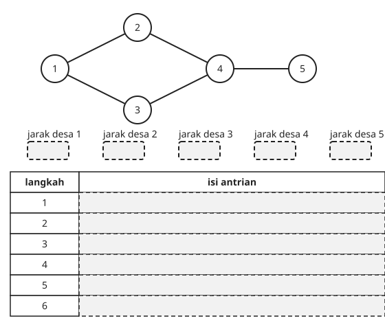

**Ingat dulu:** Tanpa melihat catatan, jawab dua soal ini.

1. Kapan memilih matriks ketetanggaan dan kapan daftar ketetanggaan? ______
2. Apa beda LIFO dan FIFO? Beri satu contoh sehari-hari untuk tiap-tiapnya. ______



`[Gambar: graf lima desa bernomor 1 sampai 5 dengan jalan dua arah 1-2, 1-3, 2-4, 3-4, dan 4-5. Di bawah tiap desa ada kotak kosong berlabel jarak. Di bawah graf tabel isi antrian dengan kolom langkah dan isi antrian, enam baris kosong.]`

Mulai dari desa 5: tulis isi antrian di tiap langkah pada tabel dan jarak akhir tiap desa pada kotaknya.

**Prediksi:** Lima desa dengan jalan dua arah 1-2, 1-3, 2-4, 3-4, dan 4-5, mulai dari desa 1. BFS memasukkan desa awal ke antrian; tiap kali mengambil satu desa dari depan, tetangganya yang belum pernah dicapai diberi jarak dan masuk antrian. Tulis tebakanmu sebelum menjalankan.

```cpp
#include <iostream>
#include <queue>
#include <vector>
using namespace std;

int main() {
  vector<vector<int>> adj(6);
  int sisi[5][2] = {{1, 2}, {1, 3}, {2, 4}, {3, 4}, {4, 5}};
  for (int k = 0; k < 5; k++) {
    adj[sisi[k][0]].push_back(sisi[k][1]);
    adj[sisi[k][1]].push_back(sisi[k][0]);
  }
  vector<int> dist(6, -1);
  queue<int> antrian;
  dist[1] = 0;
  antrian.push(1);
  while (!antrian.empty()) {
    int u = antrian.front();
    antrian.pop();
    cout << u << " ";
    for (int v : adj[u]) {
      if (dist[v] == -1) {
        dist[v] = dist[u] + 1;
        antrian.push(v);
      }
    }
  }
  cout << "\n";
  for (int i = 1; i <= 5; i++) {
    cout << "jarak " << i << " = " << dist[i] << "\n";
  }
}
```

Urutan desa dicetak: ______ Jarak desa 1 sampai 5: ______

**Lengkapi:** Inti BFS.

```cpp setengah-jadi
queue<int> antrian;
dist[s] = ____;
antrian.push(s);
while (!antrian.empty()) {
  int u = antrian.front();
  antrian.pop();
  for (int v : adj[u]) {
    if (dist[v] == ____) {
      dist[v] = dist[u] + ____;
      antrian.push(v);
    }
  }
}
```

**Susun:** Susun baris berikut (sudah diacak, tanpa lekuk) menjadi inti BFS. Deklarasi `queue<int> antrian;` dan `dist[s] = 0;` sudah ada. `AI: tanpa AI`.

```text
(a) }
(b) antrian.push(v);
(c) int u = antrian.front();
(d) for (int v : adj[u]) {
(e) antrian.push(s);
(f) dist[v] = dist[u] + 1;
(g) }
(h) while (!antrian.empty()) {
(i) if (dist[v] == -1) {
(j) antrian.pop();
(k) }
```

Urutan: ______

**Latihan:**

1. `AI: boleh` Tulis pseudocode lalu program yang membaca graf dan `s`, lalu mencetak jarak ke semua simpul (`-1` bila tak terjangkau). Uji simpul awal terisolasi, graf tak terhubung, dan jalur lurus.

   ______

2. `AI: boleh` Mulai dari angka 1, tiap langkah boleh menambah 1 atau mengalikan 2. Cari langkah paling sedikit mencapai `N` (`N` sampai 1000) dengan BFS. Apa "simpul" dan "sisi"-nya? ______
3. `AI: boleh` Cetak banyak simpul pada tiap jarak dari `s`.

   ______

**Cek diri:**

- [ ] Saya dapat menelusuri isi antrian BFS dengan tangan.
- [ ] Saya dapat menulis BFS dengan `dist` dan antrian.
- [ ] Saya dapat menjelaskan mengapa penanda diberikan saat masuk antrian.

**Catatan cetak (untuk guru, tidak dicetak):** dua halaman A4. Kunci ada di modul `a-xi2-m6`, bagian "Kunci dan petunjuk". Lembar tidak memuat kolom identitas.
