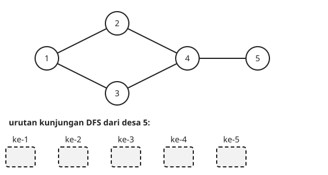

**Ingat dulu:** Tanpa melihat catatan, jawab dua soal ini.

1. Mengapa BFS memakai antrian dan dapat menemukan jarak terpendek pada graf tak berbobot? ______
2. Mengapa rekursi tanpa kasus dasar berbahaya, dan apa hubungannya dengan tumpukan pemanggilan? ______



`[Gambar: graf lima desa bernomor 1 sampai 5 dengan jalan dua arah 1-2, 1-3, 2-4, 3-4, dan 4-5. Di bawahnya baris lima kotak kosong bernomor kunjungan 1 sampai 5 untuk menulis urutan kunjungan DFS.]`

Telusuri DFS yang mulai dari desa 5 dengan fungsi `dfs` di bawah, lalu tulis urutan kunjungannya pada kotak.

**Prediksi:** Graf desa yang sama, mulai dari desa 1. Kali ini fungsi memanggil dirinya untuk tetangga pertama yang belum dikunjungi sebelum mencoba tetangga lainnya. Tulis tebakanmu sebelum menjalankan.

```cpp
#include <iostream>
#include <vector>
using namespace std;

vector<vector<int>> adj(6);
vector<bool> sudah(6, false);

void dfs(int u) {
  sudah[u] = true;
  cout << u << " ";
  for (int v : adj[u]) {
    if (!sudah[v]) {
      dfs(v);
    }
  }
}

int main() {
  int sisi[5][2] = {{1, 2}, {1, 3}, {2, 4}, {3, 4}, {4, 5}};
  for (int k = 0; k < 5; k++) {
    adj[sisi[k][0]].push_back(sisi[k][1]);
    adj[sisi[k][1]].push_back(sisi[k][0]);
  }
  dfs(1);
  cout << "\n";
}
```

Urutan desa dicetak: ______ Bedanya dengan urutan BFS dari desa yang sama: ______

**Lengkapi:** DFS rekursif.

```cpp setengah-jadi
void dfs(int u) {
  sudah[u] = ____;
  for (int v : adj[u]) {
    if (!____[v]) {
      dfs(____);
    }
  }
}
```

**Susun:** Susun baris berikut (sudah diacak, tanpa lekuk) menjadi penghitung komponen di `main`. Larik `sudah` dan fungsi `dfs(int u)` sudah ada. `AI: tanpa AI`.

```text
(a) dfs(i);
(b) }
(c) for (int i = 1; i <= n; i++) {
(d) cout << komponen << "\n";
(e) komponen++;
(f) int komponen = 0;
(g) if (!sudah[i]) {
(h) }
```

Urutan: ______

**Latihan:**

1. `AI: boleh` Tulis pseudocode lalu program yang membaca graf dan mencetak banyak komponen dan ukuran komponen terbesar. Uji `m = 0`, graf yang terhubung penuh, dan simpul terisolasi.

   ______

2. `AI: boleh` Graf tak berarah dengan `n` simpul adalah pohon bila terhubung dan `m = n - 1`. Tulis program yang mencetak `ya` atau `tidak`.

   ______

3. `AI: tanpa AI` Mengapa DFS rekursif pada rantai sejuta simpul berisiko? ______

**Cek diri:**

- [ ] Saya dapat menelusuri DFS dengan tangan dan menulis urutannya.
- [ ] Saya dapat menghitung komponen dan ukurannya.
- [ ] Saya dapat menyebut langkah DFS dan risiko kedalaman rekursinya.

**Catatan cetak (untuk guru, tidak dicetak):** dua halaman A4. Kunci ada di modul `a-xi2-m7`, bagian "Kunci dan petunjuk". Lembar tidak memuat kolom identitas.
