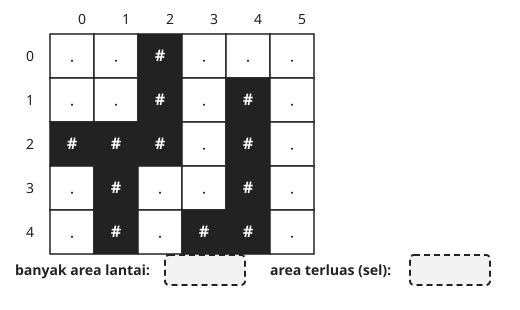

**Ingat dulu:** Tanpa melihat catatan, jawab dua soal ini.

1. Pada graf tak berarah, mengapa jumlah semua derajat sama dengan dua kali banyak sisi? ______
2. Pada array dua dimensi, indeks pertama menunjuk baris atau kolom, dan apa akibatnya membaca di luar ukuran? ______



`[Gambar: grid lima baris dan enam kolom, baris 0 sampai 4 dan kolom 0 sampai 5. Sel dinding berwarna gelap bertanda #, sel lantai putih bertanda titik. Baris 0: ..#...; baris 1: ..#.#.; baris 2: ###.#.; baris 3: .#..#.; baris 4: .#.##. Di bawahnya dua kotak kosong untuk banyak area lantai dan area terluas.]`

**Prediksi:** Dua lantai berada di area yang sama bila bisa dicapai lewat langkah atas, bawah, kiri, atau kanan (bukan miring) yang hanya melewati lantai. Dari gambar, tulis tebakanmu.

Banyak area lantai: ______ Area terluas: ______ sel.

**Lengkapi:** Potongan yang menghitung banyak tetangga lantai dari sel `(i, j)` pada grid `g` berukuran `R` kali `C`.

```cpp setengah-jadi
int dx[4] = {-1, 1, 0, 0};
int dy[4] = {0, 0, -1, 1};
int tetangga = 0;
for (int k = 0; k < ____; k++) {
  int a = i + dx[k];
  int b = j + ____[k];
  if (a < 0 || a >= ____ || b < 0 || b >= C) {
    continue;
  }
  if (g[a][b] == '.') {
    tetangga++;
  }
}
```

**Susun:** Susun baris berikut menjadi satu langkah memeriksa empat tetangga sel `(x, y)` pada BFS jarak. `AI: tanpa AI`.

```text
(a)   if (a < 0 || a >= R || b < 0 || b >= C) continue;
(b)   for (int k = 0; k < 4; k++) {
(c)     int a = x + dx[k], b = y + dy[k];
(d)     jarak[a][b] = jarak[x][y] + 1;
(e)     q.push({a, b});
(f)   }
(g)     if (g[a][b] == '#' || jarak[a][b] != -1) continue;
```

Urutan: ______

**Latihan:**

1. `AI: tanpa AI` Pada labirin tanpa dinding berukuran 3 kali 3 dengan `S` di pojok kiri atas dan `T` di pojok kanan bawah, berapa jarak terpendek? ______ Berapa sel yang berjarak tepat 2 dari `S`? ______
2. `AI: boleh` Pada grid `#` (daratan) dan `.` (laut), hitung banyak pulau bila daratan yang bersentuhan miring juga dianggap satu pulau (delapan arah). Tulis pseudocode dulu.

   ______

3. `AI: boleh` Ubah program labirin agar mencetak `tidak ada jalan` untuk grid satu sel `S` tanpa `T`, dan agar tidak membaca di luar grid pada `R = 1`.

   ______

**Cek diri:**

- [ ] Saya dapat menjelaskan sel sebagai simpul dan sel bersebelahan sebagai sisi.
- [ ] Saya dapat menulis `dx` dan `dy` dan memeriksa batas sebelum membaca sel.
- [ ] Saya dapat mencari jarak terpendek di labirin dan melaporkan bila tidak ada jalan.

**Catatan cetak (untuk guru, tidak dicetak):** dua halaman A4. Kunci ada di modul `a-xi2-m8`, bagian "Kunci dan petunjuk". Bagian Prediksi memakai grid pada gambar tanpa kode. Lembar tidak memuat kolom identitas.
