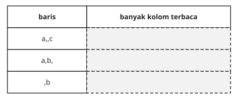

**Ingat dulu:** Tanpa melihat catatan, jawab dua soal ini.

1. Mengapa batas grid diperiksa sebelum sel tetangga dibaca? ______
2. Apa yang terjadi bila lupa menandai simpul sebagai sudah dikunjungi saat memasukkannya ke antrian? ______



`[Gambar: tabel dengan kolom baris dan banyak kolom terbaca. Tiga baris: "a,,c", "a,b,", dan ",b". Kolom banyak kolom terbaca kosong untuk kamu isi.]`

Tebak banyak kolom yang dikembalikan pemecahan koma (`getline(ss, bagian, ',')` berulang) untuk tiap baris. Lalu jalankan dan bandingkan.

**Prediksi:** Satu baris CSV berisi kolom yang dipisah koma. Tulis tebakanmu sebelum menjalankan.

```cpp
#include <iostream>
#include <sstream>
#include <string>
using namespace std;

int main() {
  string baris = "2026-01-05,minuman,12";
  istringstream ss(baris);
  string bagian;
  int nomor = 0;
  while (getline(ss, bagian, ',')) {
    nomor++;
    cout << nomor << ": [" << bagian << "]\n";
  }
  cout << nomor << " kolom\n";
}
```

Yang tercetak, baris demi baris: ______

**Lengkapi:** Fungsi yang memecah satu baris menjadi `vector<string>` berdasarkan koma.

```cpp setengah-jadi
vector<string> pecah(const string& baris) {
  vector<string> kolom;
  istringstream ss(____);
  string bagian;
  while (getline(ss, bagian, ____)) {
    kolom.____(bagian);
  }
  return kolom;
}
```

**Susun:** Susun baris berikut menjadi program yang menghitung banyak baris sesudah baris judul dari `cin`. `AI: tanpa AI`.

```text
(a)   while (getline(cin, baris)) {
(b)     banyak++;
(c)   }
(d)   cout << banyak << "\n";
(e)   getline(cin, baris);
(f)   string baris;
(g)   int banyak = 0;
(h)   cin.tie(nullptr);
```

Urutan: ______

**Latihan:**

1. `AI: boleh` Pada `data.csv` contoh, tulis program yang mencetak jumlah penjualan hanya untuk kategori `minuman` pada baris yang sah. Tulis pseudocode dulu.

   ______

2. `AI: boleh` Perluas program agar baris yang diawali `#` dilewati tanpa dihitung ditolak, dan baris kosong dilewati.

   ______

3. `AI: boleh` Berkas hanya berisi baris judul, atau kosong sama sekali. Apa keluaran programmu, dan apakah ada pembacaan yang bermasalah? ______

**Cek diri:**

- [ ] Saya dapat memecah satu baris CSV dengan `istringstream` dan `getline`.
- [ ] Saya dapat membuang baris judul dan menolak baris rusak sambil menghitungnya.
- [ ] Saya memakai data sintetis atau data berlisensi, tidak data orang nyata.

**Catatan cetak (untuk guru, tidak dicetak):** dua halaman A4. Kunci ada di modul `a-xi2-m9`, bagian "Kunci dan petunjuk". Lembar tidak memuat kolom identitas.
