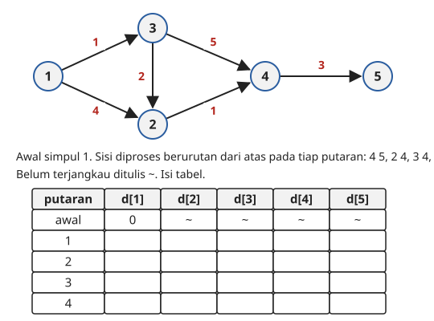

**Ingat dulu:** Tanpa melihat catatan, jawab. (1) Kapan daftar tetangga lebih cocok daripada matriks tetangga? ______ (2) Mengapa DFS tidak menjamin lintasan terpendek? ______



`[Gambar: graf berarah lima simpul dengan sisi 1-3 bobot 1, 1-2 bobot 4, 3-2 bobot 2, 3-4 bobot 5, 2-4 bobot 1, dan 4-5 bobot 3, awal simpul 1. Di bawahnya tabel d[1] sampai d[5] dengan baris awal (0 dan empat tanda ~) dan baris putaran 1 sampai 4 yang kosong untuk kamu isi.]`

**Prediksi:** Tebak dulu, tulis, baru periksa. Tiga desa: jalan 1-3 sejauh 10, 1-2 sejauh 3, 2-3 sejauh 4. Berapa sisi pada lintasan tersingkat dari desa 1 ke 3, dan berapa panjang lintasan terpendek berbobotnya? ______

Pada graf di gambar, isi `d[1..5]` sesudah putaran 1, 2, 3, dan 4 pada tabel. Pada putaran ke berapa `d[5]` tidak berubah lagi? ______

**Lengkapi:** Isi bagian kosong pada inti Bellman-Ford.

```cpp setengah-jadi
for (int putaran = 1; putaran < ____; putaran++) {
  for (const Sisi& e : sisi) {
    if (d[e.dari] != INF && d[e.dari] + ____ < d[____]) {
      d[e.ke] = d[e.dari] + e.bobot;
    }
  }
}
```

**Susun:** Urutkan baris berikut menjadi satu langkah BFS 0-1 untuk simpul `u` yang baru keluar dari `deque`. `AI: tanpa AI`

```text
(a)     if (d[u] + w < d[v]) {
(b)       d[v] = d[u] + w;
(c)       if (w == 0) dq.push_front(v);
(d)       else dq.push_back(v);
(e)     }
(f)   for (const auto& e : adj[u]) {
(g)     int v = e.first, w = e.second;
(h)   }
```

Urutan: ______

**Latihan:**

1. `AI: boleh` Graf berarah lima simpul, awal 1: `1 2 4`, `1 3 6`, `3 2 -3`, `2 4 -1`, `3 5 5`, `4 5 2` (dari, ke, bobot). Tulis pseudocode, lalu `d[1..5]` dengan Bellman-Ford. ______
2. `AI: tanpa AI` Pada graf nomor 1, sisi diproses berurutan `4 5 2`, `2 4 -1`, `3 5 5`, `3 2 -3`, `1 2 4`, `1 3 6`. Tulis `d` sesudah tiap putaran. Berapa putaran `d` masih berubah? ______
3. `AI: boleh` Pada graf halte tak berarah berbobot 0 atau 1, cetak koin minimum dari halte 1 ke halte `n`. Apa yang rusak bila ada ruas bobot 2? ______
4. `AI: boleh` Mengapa program memeriksa `d[e.dari] != INF` sebelum menambahkan bobot? ______

**Cek diri:**

- [ ] Saya dapat menelusuri Bellman-Ford putaran demi putaran dan mendeteksi siklus negatif.
- [ ] Saya dapat menulis BFS 0-1 dengan `deque`.
- [ ] Saya dapat menyebut `O(n * m)` untuk Bellman-Ford dan `O(n + m)` untuk BFS 0-1.

**Catatan cetak (untuk guru, tidak dicetak):** satu halaman A4 (dapat dua halaman bila ruang jawab diperbesar). Kunci ada di modul `a-xii1-m1`, bagian "Kunci dan petunjuk". Lembar tidak memuat kolom nama, kelas, tanggal, atau nilai; penandaan kertas diurus guru di sekolah.
