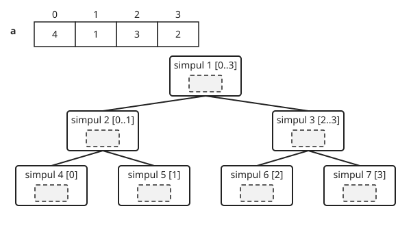

**Ingat dulu:** Tanpa melihat catatan, jawab dua soal ini.

1. Berapa langkah `tambah` dan `jumlahPrefiks` pada Fenwick, dan apa yang dihitung `i & -i`? ______
2. Tulis rumus inklusi-eksklusi untuk `|A ∪ B|`, dan mengapa irisan dikurangkan? ______



`[Gambar: larik a berindeks 0 sampai 3 berisi 4, 1, 3, 2. Di bawahnya pohon dengan tujuh simpul bernomor 1 sampai 7: simpul 1 menaungi rentang 0..3, simpul 2 rentang 0..1, simpul 3 rentang 2..3, simpul 4 sampai 7 masing-masing rentang satu elemen 0, 1, 2, 3. Tiap simpul punya kotak kosong untuk nilai minimum rentangnya.]`

Isi nilai minimum tiap simpul, dari simpul paling bawah ke atas.

**Prediksi:** Tiap simpul menyimpan minimum rentangnya; simpul `node` punya anak `2 * node` (separuh kiri) dan `2 * node + 1` (separuh kanan). Tulis tebakanmu sebelum menjalankan.

```cpp
#include <algorithm>
#include <iostream>
#include <vector>
using namespace std;

vector<int> a = {4, 1, 3, 2};
vector<int> tree(16);

void bangun(int node, int l, int r) {
  if (l == r) {
    tree[node] = a[l];
    return;
  }
  int mid = (l + r) / 2;
  bangun(2 * node, l, mid);
  bangun(2 * node + 1, mid + 1, r);
  tree[node] = min(tree[2 * node], tree[2 * node + 1]);
}

int main() {
  bangun(1, 0, 3);
  for (int i = 1; i <= 7; i++) {
    cout << tree[i] << " ";
  }
  cout << "\n";
}
```

`tree[1]` sampai `tree[7]`: ______ Simpul yang menyimpan minimum seluruh larik: ______ Simpul yang menyimpan satu elemen: ______

**Lengkapi:** Kueri minimum rentang.

```cpp setengah-jadi
int kueri(int node, int l, int r, int ql, int qr) {
  if (qr < l || r < ql) {
    return ____;
  }
  if (ql <= l && r <= qr) {
    return tree[____];
  }
  int mid = (l + r) / 2;
  return min(kueri(2 * node, l, mid, ql, qr), kueri(____, mid + 1, r, ql, qr));
}
```

**Susun:** Susun baris berikut (sudah diacak, tanpa lekuk) menjadi bagian akhir fungsi `ubah(node, l, r, pos, val)`, yaitu sesudah kasus daun. `AI: tanpa AI`.

```text
(a) ubah(2 * node + 1, mid + 1, r, pos, val);
(b) } else {
(c) tree[node] = min(tree[2 * node], tree[2 * node + 1]);
(d) int mid = (l + r) / 2;
(e) ubah(2 * node, l, mid, pos, val);
(f) if (pos <= mid) {
(g) }
```

Urutan: ______

**Latihan:**

1. `AI: tanpa AI` Untuk larik `4 1 3 2` dan kueri `3..4` (berbasis 1), tulis simpul yang dikunjungi, nilai yang dikembalikan tiap simpul, dan hasilnya.

   ______

2. `AI: boleh` Tulis pseudocode lebih dulu, lalu program minimum rentang. Uji `n = 1`, `l = r`, dan pembaruan di posisi pertama dan terakhir.

   ______

3. `AI: boleh` Ubah segment tree menjadi penjawab jumlah rentang. Apa yang menjadi nilai netral dan cara menggabung anak? ______

**Cek diri:**

- [ ] Saya dapat menggambar segment tree untuk larik berisi empat sampai delapan elemen.
- [ ] Saya dapat menyebut tiga kasus kueri dan nilai yang dikembalikan tiap kasus.
- [ ] Saya dapat membedakan kapan memakai Fenwick dan kapan segment tree.

**Catatan cetak (untuk guru, tidak dicetak):** dua halaman A4. Kunci ada di modul `a-xii1-m10`, bagian "Kunci dan petunjuk". Lembar tidak memuat kolom identitas.
