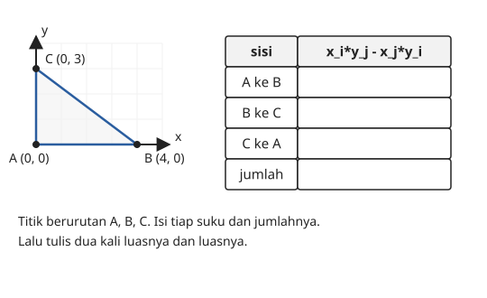

**Ingat dulu:** Tanpa melihat catatan, jawab. (1) Kapan invers `a` modulo `m` ada, dan bagaimana mencarinya bila `m` prima? ______ (2) Apa beda pohon rentang minimum dan pohon lintasan terpendek dari satu simpul? ______



`[Gambar: bidang koordinat dengan segitiga bertitik sudut A (0, 0), B (4, 0), dan C (0, 3). Di sampingnya tabel kosong untuk suku x_i * y_j - x_j * y_i pada sisi A ke B, B ke C, C ke A, dan baris jumlah.]`

**Prediksi:** Tebak dulu, tulis, baru periksa. Berapa panjang sisi miring segitiga siku-siku dengan sisi 3 dan 4, yang dihitung `hypot(3, 4)`? ______ Apa hasil perbandingan `sqrt(2) * sqrt(2) == 2` (1 bila benar, 0 bila salah)? ______ Mengapa hasil itu mengkhawatirkan untuk program geometri? ______

**Lengkapi:** Isi fungsi dua kali luas poligon.

```cpp setengah-jadi
long long luasDua(const vector<long long>& x, const vector<long long>& y) {
  int n = x.size();
  long long jumlah = 0;
  for (int i = 0; i < n; i++) {
    int j = (i + ____) % n;
    jumlah += x[i] * y[____] - x[j] * y[i];
  }
  return jumlah < 0 ? ____ : jumlah;
}
```

**Susun:** Urutkan enam baris berikut (tanpa lekuk) menjadi penghitung keliling poligon dari larik `x` dan `y`. `AI: tanpa AI`

```text
(a) cout << keliling << "\n";
(b) int j = (i + 1) % n;
(c) for (int i = 0; i < n; i++) {
(d) }
(e) keliling += hypot(x[j] - x[i], y[j] - y[i]);
(f) double keliling = 0;
```

Urutan: ______

**Latihan:**

1. `AI: tanpa AI` Hitung dengan tangan dua kali luas segitiga di gambar dengan rumus tali sepatu: isi tabel, lalu tulis luasnya. ______
2. `AI: boleh` Untuk titik `a`, `b`, `c`, hitung `(bx - ax) * (cy - ay) - (by - ay) * (cx - ax)`. Apa arti tanda positif, negatif, dan nol? ______
3. `AI: boleh` Poligon sederhana adalah konveks bila semua belok berturutan memiliki tanda yang sama. Tulis rancangan programnya. ______
4. `AI: tanpa AI` Mengapa membandingkan dua jarak lewat kuadrat lebih baik daripada lewat `sqrt` dan perbandingan `double`? ______

**Cek diri:**

- [ ] Saya dapat menjelaskan mengapa jarak dibandingkan lewat kuadrat.
- [ ] Saya dapat memakai rumus tali sepatu dan menyebut arti tandanya.
- [ ] Saya dapat menyebut tipe data yang aman untuk koordinat besar.

**Catatan cetak (untuk guru, tidak dicetak):** satu halaman A4. Kunci ada di modul `a-xii1-m11`, bagian "Kunci dan petunjuk". Lembar tidak memuat kolom nama, kelas, tanggal, atau nilai; penandaan kertas diurus guru di sekolah.
