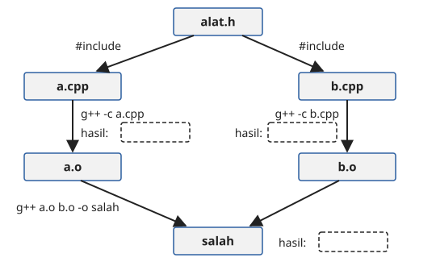

**Ingat dulu:** Tanpa melihat catatan, jawab. (1) Mengapa jarak dibandingkan lewat kuadratnya, dan tipe apa dipakai? ______ (2) Mengapa jumlah rentang `[l, r]` ditulis `prefiks(r) - prefiks(l - 1)`? ______



`[Gambar: alat.h disertakan oleh a.cpp dan b.cpp. a.cpp dikompilasi dengan g++ -c menjadi a.o dan b.cpp menjadi b.o, lalu a.o dan b.o ditautkan menjadi program salah. Di tiap langkah ada kotak kosong bertanda hasil untuk kamu isi berhasil atau gagal.]`

**Prediksi:** Tebak dulu, tulis, baru periksa. Tiga berkas ini dikompilasi masing-masing dengan `g++ -c`, lalu `a.o` dan `b.o` ditautkan.

```cpp setengah-jadi
// alat.h
int kuadrat(int x) { return x * x; }
```

```cpp setengah-jadi
// a.cpp
#include "alat.h"
int dariA() { return kuadrat(3); }
```

```cpp setengah-jadi
// b.cpp
#include "alat.h"
#include <iostream>
int dariA();
int main() { std::cout << dariA() + kuadrat(4) << "\n"; }
```

Isi tiga kotak hasil pada gambar. Mengapa penautan menghasilkan hasil itu? ______

**Lengkapi:** Header tanpa penjaga menimbulkan galat jika terbaca dua kali. Isi penjaga.

```cpp setengah-jadi
#ifndef ____
#define ____
struct Titik {
  int x;
  int y;
};
#____
```

**Susun:** Urutkan enam baris berikut menjadi `Makefile` dua aturan: variabel, lalu aturan `peta`, lalu aturan `main.o`. Baris perintah diawali karakter tab. `AI: tanpa AI`

```text
(a) peta: main.o graf.o
(b) CXX = g++
(c) g++ main.o graf.o -o peta
(d) main.o: main.cpp graf.h
(e) g++ -std=c++17 -Wall -Wextra -Werror -c main.cpp -o main.o
(f) CXXFLAGS = -std=c++17 -Wall -Wextra -Werror
```

Urutan: ______

**Latihan:**

1. `AI: boleh` Pindahkan `jarakKuadrat` dan `luasDua` dari modul `a-xii1-m11` ke `geo.h` dan `geo.cpp`, dan beri `main.cpp` yang memakainya. Tulis pseudocode pembagiannya. ______
2. `AI: tanpa AI` `titik.h` berisi `struct Titik` tanpa penjaga, dan `main.cpp` menyertakan `geo.h` (yang menyertakan `titik.h`) lalu `titik.h` lagi. Tebak galatnya. ______
3. `AI: boleh` Tambahkan `jarakAntara(adj, a, b)` ke pustaka graf dan ubah `uji.cpp`. Berkas mana yang harus dikompilasi ulang? ______
4. `AI: boleh` Tulis tiga jenis pesan galat dan tentukan tahap yang memunculkan masing-masing: kompilasi atau penautan. ______

**Cek diri:**

- [ ] Saya dapat mengompilasi dua berkas `.cpp` menjadi `.o` lalu menautkannya.
- [ ] Saya dapat menjelaskan penjaga `#ifndef`.
- [ ] Saya dapat membedakan galat kompilasi dan galat penautan.

**Catatan cetak (untuk guru, tidak dicetak):** satu halaman A4. Kunci ada di modul `a-xii1-m12`, bagian "Kunci dan petunjuk". Lembar tidak memuat kolom nama, kelas, tanggal, atau nilai; penandaan kertas diurus guru di sekolah.
