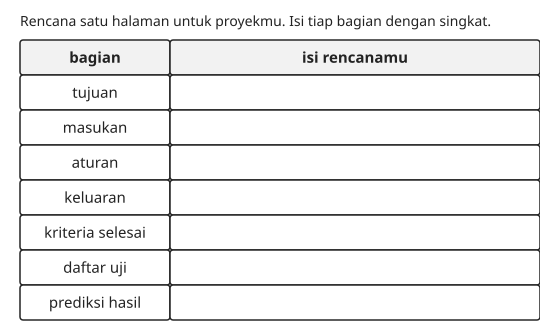

**Ingat dulu:** Tanpa melihat catatan, jawab. (1) Apa isi berkas `.h` dan apa isi berkas `.cpp`, dan mengapa satu fungsi didefinisikan tepat sekali? ______ (2) Operasi apa yang dilayani segment tree tetapi tidak Fenwick? Jelaskan dengan minimum. ______

`[Gambar: tabel dua kolom dengan tujuh bagian rencana proyek (tujuan, masukan, aturan, keluaran, kriteria selesai, daftar uji, prediksi hasil), kolom isinya kosong untuk kamu tulis.]`

**Prediksi:** Mulailah dari pertanyaan yang harus dijawab program, bukan dari alat. Isi tabel rencana pada gambar untuk proyekmu sendiri dengan data karangan, termasuk prediksi hasil sebelum program ditulis. ______

**Latihan:**

1. `AI: boleh` Pada contoh omzet harian kantin, tambahkan perintah `S l r` yang mencetak rata-rata omzet (jumlah dibagi banyak hari). Pilih tipe bilangan agar tak terpotong. ______
2. `AI: tanpa AI` Mengapa pembaruan Fenwick memakai selisih `nilai baru - nilai lama`, bukan nilai baru? ______
3. `AI: boleh` Mengapa pustaka perlu penjaga `#ifndef` bila dipakai `main.cpp` dan `uji.cpp` sekaligus? ______

**Cek diri:**

- [ ] Saya dapat menyebut pertanyaan, struktur data, dan kriteria selesai proyek saya.
- [ ] Saya menulis pseudocode sebelum program.
- [ ] Saya membagi program menjadi pustaka dan program utama.
- [ ] Saya dapat memberi umpan balik dalam tiga bagian: satu yang baik, satu yang perlu diperbaiki, satu langkah berikutnya.

**Catatan cetak (untuk guru, tidak dicetak):** satu halaman A4. Modul ini proyek, jadi lembar hanya memuat rencana dan latihan; contoh, daftar periksa, dan kunci ada di modul `a-xii1-m13` (bagian "Rencana proyek", "Daftar periksa", dan "Kunci dan petunjuk"). Bagian Lengkapi dan Susun dilewati karena modul tidak memuat soal setengah jadi atau Parsons. Lembar tidak memuat kolom nama, kelas, tanggal, atau nilai; penandaan kertas diurus guru di sekolah.
