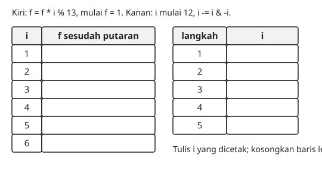

**Ingat dulu:** Ini inti asesmen. Tanpa melihat catatan, jawab. (1) Apa arti tanda hasil perkalian silang `(b - a) x (c - a)`? ______ (2) Sebutkan tiga kasus pada kueri rekursif segment tree. ______ (3) Mengapa algoritma Dijkstra tidak boleh dipakai bila ada sisi berbobot negatif? ______



`[Gambar: tabel kiri dengan i dari 1 sampai 6 dan kolom f sesudah putaran yang kosong; tabel kanan dengan lima baris langkah dan kolom i yang kosong.]`

**Latihan:** Kerjakan sendiri, `AI: tanpa AI`, dengan waktu yang ditetapkan gurumu.

1. **Tulis.** Tulis pseudocode lalu program: baca graf tak berarah `n m` dan `m` sisi, hitung jarak BFS dari simpul 1, dan cetak simpul terjauh beserta jaraknya (bila seri, pilih nomor terkecil). ______
2. **Telusuri.** Sebuah program memakai `P = 13` dan `f = 1`; untuk `i` dari 1 sampai 6 ia menghitung `f = f * i % P` dan mencetak `f`. Lalu ia mencetak `i` pada perulangan `for (int i = 12; i > 0; i -= i & -i)`. Isi dua tabel pada gambar. Apa arti baris kedua bagi Fenwick? ______
3. **Cari galat.** Tiga potongan berikut sengaja salah. Untuk tiap potongan tulis galatnya, akibatnya, dan perbaikannya. ______

   ```cpp setengah-jadi
   (a) int a, b, m;  cin >> a >> b >> m;  int hasil = a * b % m;   // a, b sampai 10^9
   (b) // alat.h tanpa penjaga dan tanpa inline, disertakan oleh dua berkas .cpp
       int kuadrat(int x) { return x * x; }
   (c) for (int i = 0; i <= n; i++) tambah(i, nilai[i]);   // Fenwick
   ```

4. **Strategi.** (a) Pohon berakar punya `n` simpul: berapa sisinya, dan mengapa BFS dari akar memberi kedalaman tiap simpul? (b) Hitung `C(5, 2)` dengan segitiga Pascal. (c) Kueri maksimum rentang dengan pembaruan titik pada `n = 10^5` data: pilih Fenwick atau segment tree, dengan perkiraan langkah tiap operasi. ______

**Cek diri:**

- [ ] Saya dapat menelusuri BFS dan menyebut jarak terpendek pada graf tak berbobot.
- [ ] Saya dapat menelusuri Fenwick dan memilihnya atau segment tree dengan alasan.
- [ ] Saya dapat membedakan galat kompilasi dan galat penautan.

**Catatan cetak (untuk guru, tidak dicetak):** satu halaman A4. Modul ini asesmen, jadi bagian Prediksi, Lengkapi, dan Susun dilewati karena modul tidak memuatnya. Kunci ada di modul `a-xii1-m14`, bagian "Kunci dan petunjuk". Lembar tidak memuat kolom nama, kelas, tanggal, atau nilai; penandaan kertas diurus guru di sekolah.
