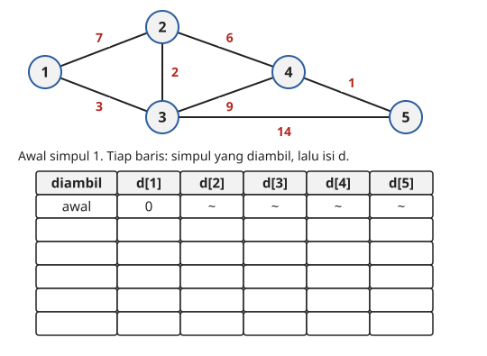

**Ingat dulu:** Tanpa melihat catatan, jawab. (1) Berapa putaran Bellman-Ford melonggarkan semua sisi, dan mengapa sebanyak itu cukup? ______ (2) Bagaimana membuat `priority_queue` mengeluarkan elemen terkecil lebih dulu? ______



`[Gambar: graf tak berarah lima kota dengan biaya 1-2 tujuh, 1-3 tiga, 3-2 dua, 2-4 enam, 3-4 sembilan, 4-5 satu, dan 3-5 empat belas. Di bawahnya tabel dengan kolom diambil dan d[1] sampai d[5]; baris awal berisi 0 dan empat tanda ~, lima baris lain kosong untuk kamu isi.]`

**Prediksi:** Tebak dulu, tulis, baru periksa. Tiga desa, jalan dua arah: 1-2 sejauh 4, 1-3 sejauh 2, 2-3 sejauh 1. Mulai dari desa 1, selalu ambil desa yang jarak sementaranya terkecil. Dalam urutan apa desa diambil, dan berapa jarak finalnya? Berapa `d[2]` sesudah desa 1 diambil, dan berapa sesudah desa 3 diambil? ______

**Lengkapi:** Isi tiga bagian kosong Dijkstra: pembanding antrian, penyaring entri usang, dan penyimpan rute.

```cpp setengah-jadi
priority_queue<pair<long long, int>, vector<pair<long long, int>>,
               ____<pair<long long, int>>> pq;
// ...
if (d > ____[u]) {
  continue;
}
// ...
if (nd < dist[v]) {
  dist[v] = nd;
  asal[v] = ____;
  pq.push({nd, v});
}
```

**Susun:** Urutkan tujuh baris berikut menjadi inti perulangan Dijkstra. `AI: tanpa AI`

```text
(a)   pq.pop();
(b)   int u = teratas.second;
(c) while (!pq.empty()) {
(d)   if (teratas.first > dist[u]) continue;
(e)   pair<long long, int> teratas = pq.top();
(f)   // longgarkan semua sisi dari u
(g) }
```

Urutan: ______

**Latihan:**

1. `AI: boleh` Pada jaringan di gambar, tulis pseudocode lalu cari biaya dan rute termurah dari 1 ke 5. ______
2. `AI: tanpa AI` Pada graf yang sama, isi tabel di gambar: simpul yang diambil lalu `d` tiap kali. ______
3. `AI: boleh` Tambahkan larik `cacah` agar program mencetak banyaknya rute terpendek ke tiap simpul. Tulis rancangannya. ______
4. `AI: boleh` Beri graf tiga simpul dengan satu sisi negatif yang membuat versi "keluar berarti final" salah. Tulis jarak keliru dan yang benar. ______

**Cek diri:**

- [ ] Saya dapat menjelaskan mengapa simpul yang keluar lebih dulu sudah final.
- [ ] Saya dapat membangun rute dengan larik `asal`.
- [ ] Saya dapat menyebut `O((n + m) log n)`.

**Catatan cetak (untuk guru, tidak dicetak):** satu halaman A4. Kunci ada di modul `a-xii1-m2`, bagian "Kunci dan petunjuk". Lembar tidak memuat kolom nama, kelas, tanggal, atau nilai; penandaan kertas diurus guru di sekolah.
