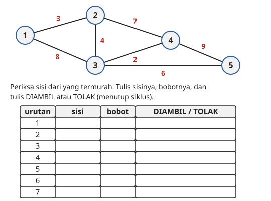

**Ingat dulu:** Tanpa melihat catatan, jawab. (1) Mengapa Dijkstra tidak boleh dipakai pada sisi bobot negatif? ______ (2) Mengapa pembanding untuk `std::sort` memakai `<`, bukan `<=`? ______



`[Gambar: graf tak berarah lima gedung dengan biaya kabel 1-2 tiga, 1-3 delapan, 2-3 empat, 2-4 tujuh, 3-4 dua, 3-5 enam, dan 4-5 sembilan. Di bawahnya tabel tujuh baris bernomor urutan dengan kolom sisi, bobot, dan DIAMBIL atau TOLAK yang kosong untuk kamu isi.]`

**Prediksi:** Tebak dulu, tulis, baru periksa. Empat desa akan dihubungkan kabel (desa, desa, biaya): `1 2 5`, `2 3 1`, `1 3 2`, `3 4 4`, `2 4 6`. Periksa sisi dari yang termurah; ambil sisi bila ia menghubungkan dua desa yang belum terhubung lewat kabel yang sudah diambil. Sisi mana yang diambil, mana yang ditolak, dan berapa biaya totalnya? Berapa sisi yang diambil, dan apa hubungannya dengan 4 desa? ______

**Lengkapi:** Isi pembanding urutan dan pemeriksaan siklus.

```cpp setengah-jadi
bool lebihDulu(const Sisi& a, const Sisi& b) {
  return a.____ < b.____;
}
// ...
if (komp[e.u] ____ komp[e.v]) {
  continue;  // sisi ini menutup siklus
}
```

**Susun:** Urutkan enam baris berikut menjadi satu langkah Kruskal untuk sisi `e`. `AI: tanpa AI`

```text
(a)   int lama = komp[e.v];
(b)   for (int i = 1; i <= n; i++) {
(c)     if (komp[i] == lama) komp[i] = komp[e.u];
(d)   }
(e)   total += e.bobot;
(f)   if (komp[e.u] == komp[e.v]) continue;
```

Urutan: ______

**Latihan:**

1. `AI: boleh` Pada jaringan gambar, tulis pseudocode lalu cari biaya minimum. ______
2. `AI: tanpa AI` Pada graf yang sama, isi tabel pemeriksaan sisi di gambar, lalu tulis larik `komp` sesudah tiap sisi diambil. ______
3. `AI: boleh` Tambahkan keluaran banyak komponen graf. Apa yang kamu ubah? ______
4. `AI: boleh` Ubah program agar menghasilkan pohon rentang dengan biaya terbesar. Apa satu baris yang diubah? ______

**Cek diri:**

- [ ] Saya dapat menjelaskan pohon rentang dan mengapa sisinya `n - 1`.
- [ ] Saya dapat menjalankan Kruskal dengan tangan.
- [ ] Saya dapat mendeteksi graf tak terhubung dari jumlah sisi terpilih.

**Catatan cetak (untuk guru, tidak dicetak):** satu halaman A4. Kunci ada di modul `a-xii1-m3`, bagian "Kunci dan petunjuk". Lembar tidak memuat kolom nama, kelas, tanggal, atau nilai; penandaan kertas diurus guru di sekolah.
