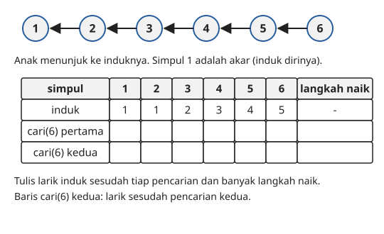

**Ingat dulu:** Tanpa melihat catatan, jawab. (1) Mengapa Kruskal mengurutkan sisi menurut bobot dan menolak sisi yang menutup siklus? ______ (2) Mengapa rekursi tanpa kasus dasar berbahaya? ______



`[Gambar: rantai enam simpul, tiap simpul menunjuk ke simpul sebelumnya sebagai induknya, simpul 1 adalah akar. Di bawahnya tabel larik induk (1 1 2 3 4 5) dan dua baris kosong untuk larik sesudah cari(6) pertama dan kedua, serta kolom banyak langkah naik.]`

**Prediksi:** Tebak dulu, tulis, baru periksa. Larik `induk` menyimpan induk tiap simpul; akar menunjuk dirinya sendiri. Fungsi `cari(x)`: bila `induk[x]` bukan `x`, hitung satu langkah naik, ganti `induk[x]` dengan `cari(induk[x])`, lalu kembalikan `induk[x]`. Pada rantai di gambar, berapa langkah naik pada `cari(6)` pertama? Tulis isi `induk` sesudahnya, dan berapa langkah naik pada pencarian kedua? ______

**Lengkapi:** Isi `cari` dan penyambungan menurut ukuran.

```cpp setengah-jadi
int cari(int x) {
  if (induk[x] != ____) {
    induk[x] = ____(induk[x]);
  }
  return induk[x];
}
// dalam gabung, setelah a dan b menjadi akar:
if (ukuran[a] ____ ukuran[b]) {
  swap(a, b);
}
```

**Susun:** Urutkan tujuh baris berikut menjadi isi `gabung(a, b)`. `AI: tanpa AI`

```text
(a)   if (a == b) return false;
(b)   a = cari(a);
(c)   b = cari(b);
(d)   induk[b] = a;
(e)   ukuran[a] += ukuran[b];
(f)   if (ukuran[a] < ukuran[b]) swap(a, b);
(g)   return true;
```

Urutan: ______

**Latihan:**

1. `AI: boleh` Enam kota, jalan dibuka berurutan: `1 2`, `3 4`, `5 6`, `2 3`, `4 5`. Tulis pseudocode, lalu banyak komponen dan ukuran komponen terbesar sesudah tiap jalan. ______
2. `AI: tanpa AI` Dari `induk[1..6] = 1 1 2 3 4 5`, tulis `induk` sesudah `cari(6)` dengan kompresi, dan banyak langkah naik pencarian pertama dan kedua. ______
3. `AI: boleh` Tambahkan perintah `U x` yang mencetak ukuran kelompok yang memuat `x`. Tulis rancangannya. ______
4. `AI: boleh` Menghitung komponen: kapan DFS cukup, dan kapan DSU lebih cocok? ______

**Cek diri:**

- [ ] Saya dapat menjelaskan kelompok sebagai pohon dengan satu akar.
- [ ] Saya dapat menulis `cari` dengan kompresi lintasan.
- [ ] Saya dapat menjelaskan mengapa DSU lebih cepat daripada label.

**Catatan cetak (untuk guru, tidak dicetak):** satu halaman A4. Kunci ada di modul `a-xii1-m4`, bagian "Kunci dan petunjuk". Lembar tidak memuat kolom nama, kelas, tanggal, atau nilai; penandaan kertas diurus guru di sekolah.
