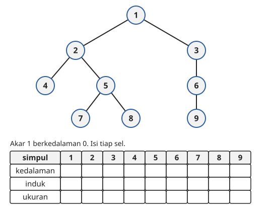

**Ingat dulu:** Tanpa melihat catatan, jawab. (1) Apa yang dilakukan kompresi lintasan pada `cari`? ______ (2) Mengapa DFS rekursif berisiko pada graf yang sangat dalam, dan apa penggantinya? ______



`[Gambar: pohon akar 1 dengan anak 2 dan 3; simpul 2 beranak 4 dan 5; simpul 3 beranak 6; simpul 5 beranak 7 dan 8; simpul 6 beranak 9. Di bawahnya tabel tiga baris (kedalaman, induk, ukuran) untuk simpul 1 sampai 9, kosong untuk kamu isi.]`

**Prediksi:** Tebak dulu, tulis, baru periksa. Pada pohon di gambar (akar kedalaman 0): berapa kedalaman simpul 9, dan siapa induk simpul 7? Berapa ukuran subpohon simpul 5, termasuk dirinya? Siapa leluhur bersama terendah simpul 7 dan 8, dan siapa untuk simpul 4 dan 9? ______

**Lengkapi:** Isi LCA sederhana: penyamaan kedalaman, lalu naik bersama.

```cpp setengah-jadi
while (kedalaman[a] > ____) {
  a = ____[a];
}
while (a != b) {
  a = induk[a];
  b = ____[b];
}
```

**Susun:** Urutkan lima baris berikut menjadi penghitung ukuran subpohon dari `urutan` BFS. `AI: tanpa AI`

```text
(a) for (int i = n - 1; i > 0; i--) {
(b)   ukuran[induk[v]] += ukuran[v];
(c) }
(d) vector<int> ukuran(n + 1, 1);
(e)   int v = urutan[i];
```

Urutan: ______

**Latihan:**

1. `AI: boleh` Pohon tujuh simpul: `1 2`, `1 3`, `2 4`, `2 5`, `3 6`, `3 7`, akar 1. Tulis pseudocode, lalu kedalaman tiap simpul dan LCA dari `(4, 5)`, `(4, 6)`, `(7, 3)`. ______
2. `AI: boleh` Pada pohon nomor 1, berapa jarak `(4, 7)` lewat LCA? ______
3. `AI: tanpa AI` Pada pohon di gambar, tulis urutan BFS dari 1 dan isi tabel induk dan ukuran. ______
4. `AI: boleh` Hitung banyak daun dan tinggi pohon (kedalaman terbesar) pada pohon di gambar. ______

**Cek diri:**

- [ ] Saya dapat menjelaskan induk, anak, daun, kedalaman, dan subpohon.
- [ ] Saya dapat mencari LCA dengan menaikkan simpul.
- [ ] Saya dapat menyebut `O(kedalaman)` per kueri dan kapan itu terlalu lambat.

**Catatan cetak (untuk guru, tidak dicetak):** satu halaman A4. Kunci ada di modul `a-xii1-m5`, bagian "Kunci dan petunjuk". Lembar tidak memuat kolom nama, kelas, tanggal, atau nilai; penandaan kertas diurus guru di sekolah.
