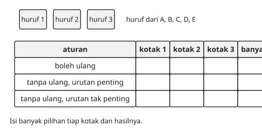

**Ingat dulu:** Tanpa melihat catatan, jawab. (1) Berapa sisi pohon rentang dari graf terhubung dengan `n` simpul? ______ (2) Berapa banyak permutasi `n` unsur, dan mengapa itu membatasi `n` pada pencarian lengkap? ______



`[Gambar: tiga kotak huruf kode loker dengan huruf dari A, B, C, D, E. Di bawahnya tabel tiga aturan (boleh ulang, tanpa ulang urutan penting, tanpa ulang urutan tak penting) dengan kolom banyak pilihan kotak 1, 2, 3 dan banyak kode, kosong untuk kamu isi.]`

**Prediksi:** Tebak dulu, tulis, baru periksa. Kode loker terdiri atas tiga huruf dari `A, B, C, D, E`. Sebuah program memakai tiga perulangan bersarang dan menghitung kode yang boleh berulang, kode tanpa ulang dengan urutan penting (`a != b && b != c && a != c`), dan kode tanpa ulang dengan urutan tak penting (`a < b && b < c`). Isi tabel di gambar. Mengapa hitungan terakhir paling kecil, dan berapa kali lipat dari yang kedua? ______

**Lengkapi:** Isi perulangan kombinasi `C(n, k)`: batas, selisih, dan pembagi.

```cpp setengah-jadi
long long c = 1;
for (int i = 1; i <= ____; i++) {
  c = c * (n - k + ____) / ____;
}
```

**Susun:** Urutkan enam baris berikut menjadi program yang membaca `n` dan `k` dan mencetak `C(n, k)`. `AI: tanpa AI`

```text
(a) cin >> n >> k;
(b) int n, k;
(c) for (int i = 1; i <= k; i++) {
(d)   c = c * (n - k + i) / i;
(e) }
(f) long long c = 1;
```

Urutan: ______

**Latihan:**

1. `AI: boleh` Rak berisi 6 buku berbeda. Berapa susunan seluruhnya, dan berapa bila dua buku tertentu harus bersebelahan? ______
2. `AI: boleh` Dari 8 orang, berapa cara memilih ketua, sekretaris, dan bendahara (orangnya berbeda), dan berapa cara memilih panitia 3 orang tanpa jabatan? ______
3. `AI: tanpa AI` Kode terdiri atas dua huruf `A` sampai `Z` lalu tiga digit `0` sampai `9`, boleh berulang. Berapa kode berbeda? ______
4. `AI: boleh` Cari `n` terbesar sehingga `n!` masih muat di `int` 32-bit dan di `long long`. Tulis rancangan programnya. ______

**Cek diri:**

- [ ] Saya dapat membedakan aturan jumlah dan aturan kali.
- [ ] Saya dapat menghitung `n!`, `P(n, k)`, dan `C(n, k)`.
- [ ] Saya dapat memeriksa rumus dengan menghitung langsung untuk `n` kecil.

**Catatan cetak (untuk guru, tidak dicetak):** satu halaman A4. Kunci ada di modul `a-xii1-m6`, bagian "Kunci dan petunjuk". Lembar tidak memuat kolom nama, kelas, tanggal, atau nilai; penandaan kertas diurus guru di sekolah.
