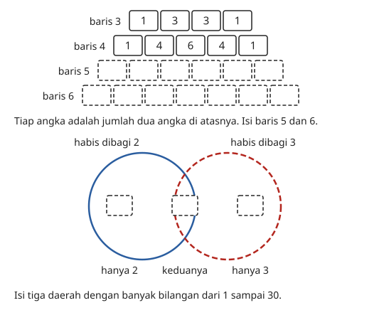

**Ingat dulu:** Tanpa melihat catatan, jawab. (1) Kapan dipakai aturan jumlah dan kapan aturan kali? ______ (2) Apa dua ciri masalah yang cocok diselesaikan dengan DP? ______



`[Gambar: segitiga Pascal; baris 3 berisi 1 3 3 1 dan baris 4 berisi 1 4 6 4 1, baris 5 dan 6 berupa kotak kosong. Di bawahnya dua lingkaran beririsan, habis dibagi 2 dan habis dibagi 3, dengan tiga kotak kosong untuk daerah hanya 2, keduanya, dan hanya 3.]`

**Prediksi:** Tebak dulu, tulis, baru periksa. Tiap angka segitiga Pascal adalah jumlah dua angka di atasnya. Isi baris 5 dan baris 6 pada gambar. Berapa `C(6, 3)`? ______ Berapa bilangan dari 1 sampai 30 yang habis dibagi 2 atau 3? Isi tiga daerah diagram di gambar. ______

**Lengkapi:** Isi pembangunan segitiga Pascal: nilai awal, batas kolom, dan baris di atas.

```cpp setengah-jadi
for (int i = 0; i <= 60; i++) {
  C[i][0] = ____;
  for (int j = 1; j <= ____; j++) {
    C[i][j] = C[i - 1][j - 1] + C[____][j];
  }
}
```

**Susun:** Urutkan enam baris berikut menjadi program yang mencetak banyak bilangan `1..N` yang habis dibagi 2 atau 3. `AI: tanpa AI`

```text
(a) long long gabungan = x + y - xy;
(b) long long xy = N / 6;
(c) cout << gabungan << "\n";
(d) int N; cin >> N;
(e) long long x = N / 2;
(f) long long y = N / 3;
```

Urutan: ______

**Latihan:**

1. `AI: boleh` Berapa `C(10, 4)`? Tulis pseudocode program yang menjawab `q` kueri `C(n, k)` dengan tabel. ______
2. `AI: boleh` Berapa bilangan dari 1 sampai 1000 yang habis dibagi 3, 5, atau 7? ______
3. `AI: tanpa AI` Dari baris 6 (`1 6 15 20 15 6 1`) tulis baris 7. Periksa bahwa jumlah baris 5 adalah `2^5`. ______
4. `AI: boleh` Berapa bilangan dari 1 sampai 60 yang tidak habis dibagi 2, 3, maupun 5? ______

**Cek diri:**

- [ ] Saya dapat menjelaskan mengapa tiap angka Pascal adalah jumlah dua angka di atasnya.
- [ ] Saya dapat menulis inklusi-eksklusi untuk dua dan tiga himpunan.
- [ ] Saya dapat memeriksa hasil rumus dengan menghitung langsung.

**Catatan cetak (untuk guru, tidak dicetak):** satu halaman A4. Kunci ada di modul `a-xii1-m7`, bagian "Kunci dan petunjuk". Lembar tidak memuat kolom nama, kelas, tanggal, atau nilai; penandaan kertas diurus guru di sekolah.
