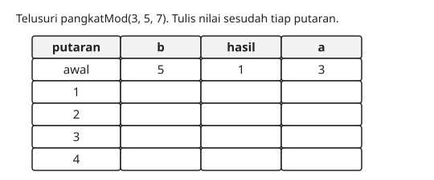

**Ingat dulu:** Tanpa melihat catatan, jawab. (1) Apa rumus peralihan Pascal untuk `C(n, k)`? ______ (2) Mengapa KPK sebaiknya dihitung `a / fpb(a, b) * b`, bukan `a * b / fpb(a, b)`? ______



`[Gambar: tabel dengan kolom putaran, b, hasil, dan a. Baris awal berisi b 5, hasil 1, a 3; empat baris putaran bernomor 1 sampai 4 kosong untuk kamu isi.]`

**Prediksi:** Tebak dulu, tulis, baru periksa. Dalam matematika, sisa bagi tak pernah negatif. Bagaimana dengan C++? Apa nilai `17 % 5`, `-17 % 5`, dan `((-17 % 5) + 5) % 5`? ______ Mengapa bentuk ketiga memberi hasil yang berbeda dari bentuk kedua? ______

**Lengkapi:** Isi pemangkatan modular.

```cpp setengah-jadi
long long pangkatMod(long long a, long long b, long long m) {
  long long hasil = ____ % m;
  a %= m;
  while (b > ____) {
    if (b % 2 == 1) {
      hasil = hasil * a % ____;
    }
    a = a * a % m;
    b /= 2;
  }
  return hasil;
}
```

**Susun:** Urutkan tujuh baris berikut (tanpa lekuk) menjadi isi perulangan `while (b > 0)` pada `pangkatMod`. `AI: tanpa AI`

```text
(a) b /= 2;
(b) }
(c) if (b % 2 == 1) {
(d) a = a * a % m;
(e) hasil = hasil * a % m;
(f) while (b > 0) {
(g) }
```

Urutan: ______

**Latihan:**

1. `AI: tanpa AI` Telusuri `pangkatMod(3, 5, 7)` putaran demi putaran dan isi tabel di gambar. ______
2. `AI: boleh` Tulis pseudocode program yang membaca banyak kueri `a b m` dan mencetak `a^b mod m`. Uji apa saja yang kamu pilih? ______
3. `AI: boleh` Untuk `m` kecil, cari invers tiap `a` dari 1 sampai `m - 1` dengan mencoba semua `x`, dan cetak "tidak ada" bila tak ada. Uji `m = 12`. ______
4. `AI: boleh` Mengapa invers `a` modulo `m` hanya ada bila `FPB(a, m) = 1`? ______

**Cek diri:**

- [ ] Saya dapat menghitung sisa bagi bilangan negatif di C++ agar jatuh di `0` sampai `m - 1`.
- [ ] Saya dapat menulis `pangkatMod` dan menyebut banyak putarannya.
- [ ] Saya dapat menjelaskan mengapa `% m` dilakukan setelah tiap operasi.

**Catatan cetak (untuk guru, tidak dicetak):** satu halaman A4. Kunci ada di modul `a-xii1-m8`, bagian "Kunci dan petunjuk". Lembar tidak memuat kolom nama, kelas, tanggal, atau nilai; penandaan kertas diurus guru di sekolah.
