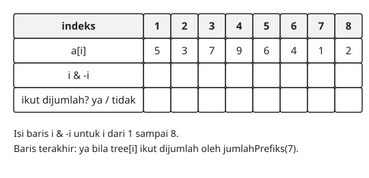

**Ingat dulu:** Tanpa melihat catatan, jawab. (1) Mengapa tiap perkalian pada pemangkatan modular diikuti `% m`? ______ (2) Mengapa pada BFS 0-1 sisi bobot 0 dimasukkan ke depan `deque` dan sisi bobot 1 ke belakang? ______



`[Gambar: tabel indeks 1 sampai 8; baris a[i] berisi 5 3 7 9 6 4 1 2; baris i & -i dan baris "ikut dijumlah? ya / tidak" masih kosong untuk kamu isi.]`

**Prediksi:** Tebak dulu, tulis, baru periksa. Operasi `i & -i` mengambil bit 1 terendah dari `i` (bilangan negatif disimpan sebagai komplemen dua). Isi baris `i & -i` untuk `i` dari 1 sampai 8 pada gambar. Pada bilangan berapa hasilnya sama dengan bilangan itu sendiri? ______

**Lengkapi:** Isi kueri jumlah prefiks.

```cpp setengah-jadi
long long jumlahPrefiks(int i) {
  long long s = ____;
  while (i > 0) {
    s += tree[____];
    i -= i & ____;
  }
  return s;
}
```

**Susun:** Urutkan enam baris berikut (tanpa lekuk) menjadi fungsi `tambah`. Larik `tree` dan ukuran `n` sudah ada. `AI: tanpa AI`

```text
(a) i += i & -i;
(b) void tambah(int i, long long v) {
(c) }
(d) tree[i] += v;
(e) while (i <= n) {
(f) }
```

Urutan: ______

**Latihan:**

1. `AI: tanpa AI` Untuk larik di gambar, isi baris terakhir: simpul `tree` mana saja yang dijumlah oleh `jumlahPrefiks(7)`, dan berapa langkahnya? ______
2. `AI: boleh` Tulis pseudocode program yang membaca `n`, larik, dan kueri tambah titik dan jumlah rentang. Uji batas apa saja? ______
3. `AI: boleh` Permutasi `a[1..n]`. Bagaimana menghitung banyak pasangan `i < j` dengan `a[i] > a[j]` dalam `O(n log n)`? ______
4. `AI: boleh` Mengapa Fenwick memakai indeks mulai dari 1? Apa yang terjadi pada `i += i & -i` bila `i = 0`? ______

**Cek diri:**

- [ ] Saya dapat menulis `tambah` dan `jumlahPrefiks` tanpa melihat catatan.
- [ ] Saya dapat menjawab jumlah rentang dari dua jumlah prefiks.
- [ ] Saya dapat menulis uji batas: `n = 1`, `l = r`, `i = n`.

**Catatan cetak (untuk guru, tidak dicetak):** satu halaman A4. Kunci ada di modul `a-xii1-m9`, bagian "Kunci dan petunjuk". Lembar tidak memuat kolom nama, kelas, tanggal, atau nilai; penandaan kertas diurus guru di sekolah.
