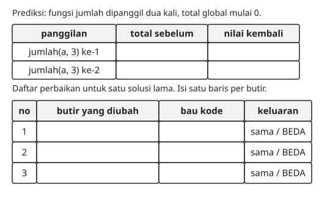

**Ingat dulu:** Tanpa melihat catatan, jawab. (1) Apa fungsi penjaga `#ifndef` pada header? ______ (2) Mengapa tabel Pascal lebih aman dari luapan daripada menghitung `n! / (k! * (n - k)!)`? ______



`[Gambar: tabel pertama dengan dua baris panggilan jumlah(a, 3) ke-1 dan ke-2, kolom total sebelum dan nilai kembali kosong. Tabel kedua berupa daftar perbaikan dengan kolom nomor, butir yang diubah, bau kode, dan keluaran sama atau BEDA, tiga baris kosong.]`

**Prediksi:** Tebak dulu, tulis, baru periksa. Fungsi `jumlah(int a[], int n)` menambahkan semua `a[i]` ke variabel global `total` (awalnya 0) tanpa menyetelnya ulang, lalu mengembalikan `total`. Dengan `a = {1, 2, 3}`, `main` mencetak `jumlah(a, 3)` dua kali. Isi tabel pertama di gambar. Mengapa fungsi seperti ini sulit dipelihara? ______

**Lengkapi:** Isi fungsi `runTerpanjang` yang menghitung deret terpanjang porsi berurutan yang sama.

```cpp setengah-jadi
int runTerpanjang(const vector<int>& porsi) {
  int terpanjang = ____;
  int saatIni = 1;
  for (size_t i = 1; i < porsi.size(); i++) {
    saatIni = (porsi[i] == porsi[____]) ? saatIni + ____ : 1;
    terpanjang = max(terpanjang, ____);
  }
  return terpanjang;
}
```

**Susun:** Urutkan tujuh baris berikut (tanpa lekuk) menjadi isi fungsi `jumlahGenap`. `AI: tanpa AI`

```text
(a) }
(b) jumlah += p;
(c) return jumlah;
(d) if (p % 2 == 0) {
(e) int jumlah = 0;
(f) }
(g) for (int p : porsi) {
```

Urutan: ______

**Latihan:** Fungsi `f` untuk nomor 1 dan 2:

```cpp
#include <vector>
using namespace std;
int f(vector<int> v, int k) {
  int c = 0;
  for (int i = 0; i < (int)v.size(); i++) {
    if (v[i] % k == 0) {
      c = c + 1;
    }
  }
  int d = 0;
  for (int i = 0; i < (int)v.size(); i++) {
    if (v[i] > 100) {
      d = d + 1;
    }
  }
  return c * 1000 + d;
}
```

1. `AI: tanpa AI` Sebut tiga bau kode di dalam `f`. ______
2. `AI: tanpa AI` Tulis ulang `f` menjadi dua fungsi bernama jelas dan satu konstanta, dengan perilaku sama untuk semua masukan. ______
3. `AI: boleh` Tulis skrip `bash` yang mengompilasi dua versi, menjalankannya pada semua berkas `masukan*.txt`, dan mencetak `sama` atau `BEDA` per berkas. ______
4. `AI: boleh` Isi satu baris tabel daftar perbaikan di gambar untuk solusi lamamu. Mengapa mengganti `int` menjadi `long long` bukan refaktor murni? ______

**Cek diri:**

- [ ] Saya dapat menyebut beda refaktor dan memperbaiki galat.
- [ ] Saya dapat merekam keluaran program lama untuk beberapa masukan sebagai uji pegangan.
- [ ] Saya dapat membandingkan keluaran lama dan baru dengan `cmp` atau `diff`.

**Catatan cetak (untuk guru, tidak dicetak):** satu halaman A4. Kunci ada di modul `a-xii2-m1`, bagian "Kunci dan petunjuk". Lembar tidak memuat kolom nama, kelas, tanggal, atau nilai; penandaan kertas diurus guru di sekolah.
