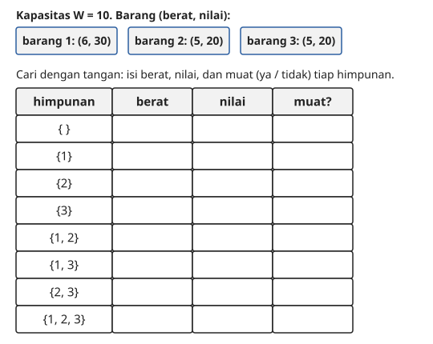

**Ingat dulu:** Tanpa melihat catatan, jawab. (1) Struktur data apa yang dipilih untuk jumlah rentang dengan pembaruan, dan berapa langkah tiap operasi? ______ (2) Apa risiko mengoptimalkan tanpa uji pembanding? ______



`[Gambar: tiga kartu barang (berat, nilai): barang 1 (6, 30), barang 2 (5, 20), barang 3 (5, 20), kapasitas 10. Di bawahnya tabel delapan himpunan bagian dengan kolom berat, nilai, dan muat, kosong untuk kamu isi.]`

**Prediksi:** Tebak dulu, tulis, baru periksa. Knapsack kecil dengan kapasitas 10 dan barang di gambar. Greedy mengurutkan menurut nilai per berat lalu mengambil barang yang masih muat. Barang mana yang diambil, dan berapa nilainya? ______ Adakah pilihan barang dengan nilai total lebih besar? Cari dengan tangan memakai tabel di gambar. ______

**Lengkapi:** Isi DP knapsack satu dimensi: kapasitas diulang dari besar ke kecil, dan barang menambah nilainya sendiri.

```cpp setengah-jadi
  vector<int> dp(W + 1, 0);
  for (int i = 0; i < n; i++) {
    int w;
    int v;
    cin >> w >> v;
    for (int c = ____; c >= w; c--) {
      dp[c] = max(dp[c], dp[c - w] + ____);
    }
  }
  cout << dp[W] << "\n";
```

**Susun:** Urutkan baris berikut menjadi isi `main` yang mencari nilai terbaik dengan pencarian lengkap pada tiga barang tetap (deklarasi `n`, `W`, `w`, `v` sudah ada). `AI: tanpa AI`

```text
cout << terbaik << "\n";
  int nilai = 0;
      berat += w[i];
  if (berat <= W && nilai > terbaik) {
int terbaik = 0;
    }
for (int mask = 0; mask < (1 << n); mask++) {
  int berat = 0;
  for (int i = 0; i < n; i++) {
    if (mask & (1 << i)) {
      nilai += v[i];
    terbaik = nilai;
  }
  }
}
```

Urutan (tulis huruf atau nomor baris dari atas ke bawah): ______

**Latihan:**

1. `AI: boleh` Untuk tiga situasi (15 barang dengan kapasitas `10^9`; seribu barang dengan kapasitas 1000; jadwal kegiatan yang dipilih menurut waktu selesai) pilih strategi dan tulis alasannya dengan perkiraan langkah. ______
2. `AI: boleh` Cari contoh tandingan untuk greedy "ambil nilai terbesar dulu" pada knapsack berkapasitas 10 dengan barang `(9, 10)`, `(5, 6)`, `(5, 6)`. Apakah greedy rasio juga salah pada contoh itu? ______
3. `AI: tanpa AI` Dengan `n = 25` dan `W = 10^9`, hitung banyak himpunan bagian dan banyak sel DP, lalu pilih strategi menurut pedoman seratus juta langkah per detik. ______
4. `AI: boleh` Mengapa memilih kegiatan yang selesai paling awal tak memerlukan DP? ______

**Cek diri:**

- [ ] Saya dapat mencari contoh tandingan untuk sebuah greedy.
- [ ] Saya dapat menghitung `2^n` dan `n * W` untuk menilai kelayakan.
- [ ] Saya dapat menjelaskan mengapa kapasitas diulang dari besar ke kecil.

**Catatan cetak (untuk guru, tidak dicetak):** satu halaman A4. Kunci ada di modul `a-xii2-m10`, bagian "Kunci dan petunjuk". Lembar tidak memuat kolom nama, kelas, tanggal, atau nilai; penandaan kertas diurus guru di sekolah.
