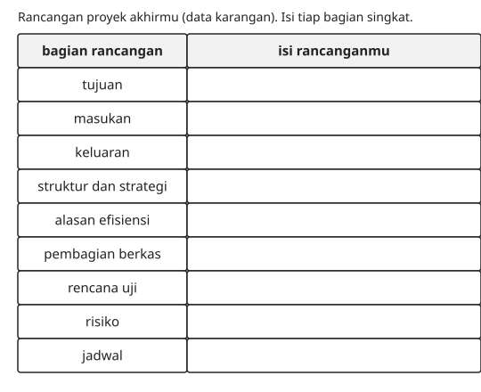

**Ingat dulu:** Tanpa melihat catatan, jawab. (1) Apa tiga pertanyaan pada tabel pemilihan strategi, dan dalam urutan apa diajukan? ______ (2) Mengapa model perlu diuji dengan penyelesaian paksa pada ukuran kecil? ______

`[Gambar: tabel dua kolom dengan sembilan bagian rancangan (tujuan, masukan, keluaran, struktur dan strategi, alasan efisiensi, pembagian berkas, rencana uji, risiko, jadwal); kolom isinya kosong untuk kamu tulis.]`

**Prediksi:** Tulis rencana sebelum menyentuh kode, lalu prediksi hasil pada contoh masukanmu. Isi tabel rancangan di gambar untuk proyek akhirmu sendiri dengan data karangan. Kriteria selesai harus bisa diperiksa, bukan "program bagus". ______

**Latihan:**

1. `AI: boleh` Tulis tiga kriteria selesai yang dapat diperiksa untuk rancangan contoh "Peta Kurir Kampung" (jarak terpendek `D`, bangun jalan `B`, kelompok `K`). ______
2. `AI: tanpa AI` Mengapa perintah `D` pada contoh memakai Dijkstra, bukan BFS, dan apa yang berubah bila ada jalan berbobot negatif? ______
3. `AI: boleh` Perkirakan langkah dan memori Fenwick dengan `n = 10^5`. ______

**Cek diri:**

- [ ] Saya dapat menyebut pertanyaan yang dijawab proyekku.
- [ ] Saya menulis spesifikasi dengan batasan angka.
- [ ] Saya memilih struktur data dan strategi dengan alasan efisiensi.

**Catatan cetak (untuk guru, tidak dicetak):** satu halaman A4. Modul ini proyek tahap rancangan, jadi bagian Lengkapi dan Susun dilewati karena modul tidak memuat soal setengah jadi atau Parsons. Kunci ada di modul `a-xii2-m11`, bagian "Kunci dan petunjuk". Lembar tidak memuat kolom nama, kelas, tanggal, atau nilai; penandaan kertas diurus guru di sekolah.
